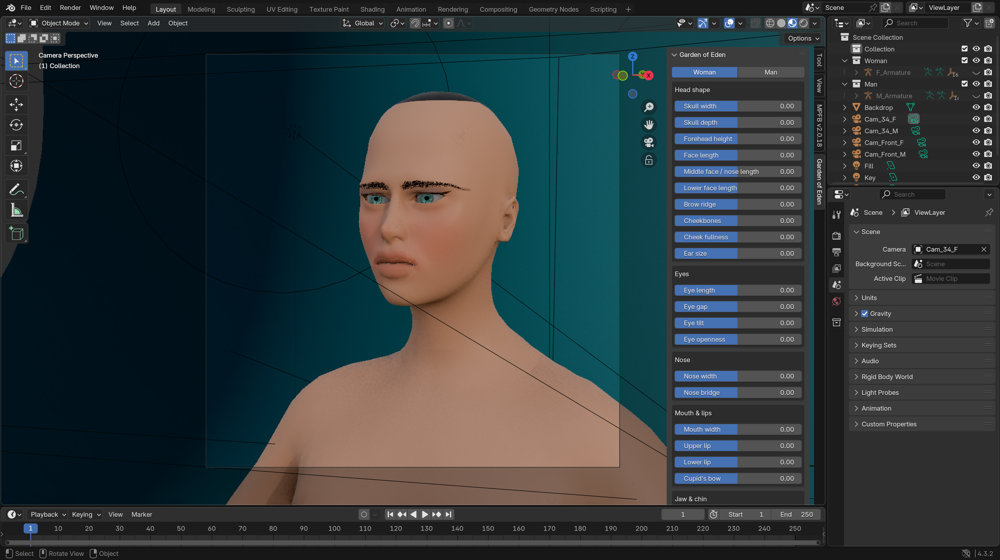

# Editing the characters by hand (beginner guide)

This is the friendly way to change how the game's people look: move sliders, look at the result, save what you like.
You do not need to know Blender. Everything here works on copies; the game files only change when you press a Save
button and then rebuild (step 5).



## 1. Open the editor

Double-click `art3d/characters/mh/open_editor.sh` (or run it in a terminal):

```
art3d/characters/mh/open_editor.sh
```

Blender opens `editor.blend` with the woman on the left and the man on the right. The **Garden of Eden** panel sits on
the right side of the 3D view. If you do not see it, move the mouse over the 3D view and press **N**, then click the
"Garden of Eden" tab.

If the file is missing, build it once (takes about 20 seconds):
```
source art3d/characters/mh/mpfb_env.sh
$B -b art3d/characters/mh/base_mh.blend -P art3d/characters/mh/make_editor.py
```

## 2. Look around (the four controls you need)

| do this | to |
|---|---|
| hold the **middle mouse button** (or two fingers on a trackpad) and drag | rotate the view |
| **scroll** the wheel (or pinch) | zoom |
| hold **Shift** + middle mouse (or Shift + two fingers) and drag | slide the view |
| press **numpad 0** (or View > Cameras > Active Camera) | look through the camera; pick the camera in the outliner (top right): `Cam_Front_F`, `Cam_34_F`, `Cam_Front_M`, `Cam_34_M`, right-click > Set Active Camera |

**Ctrl+Z** undoes the last slider move. If the people look grey, press **Z** and choose *Material Preview*.

## 3. The sliders

At the top choose **Woman** or **Man**: the sliders then act on that person. Every slider goes from **-1 to +1**.
**0 is the average real person** (measured faces, Farkas 2005); **+1 / -1 is about as far as one person in forty goes**
(two standard deviations). Values between -0.5 and 0.5 are where most people are. Big values on many sliders at once look
odd; that is normal.

### Head shape
| slider | moves | + / - | tips |
|---|---|---|---|
| Skull width | width of the skull above the ears | wider / narrower | keep within +-0.6, the face stays the same width |
| Skull depth | how far the back of the head reaches | longer / flatter | flat back of the head: -0.4 |
| Forehead height | brow to hairline | taller / shorter forehead | |
| Face length | the whole face, top to bottom | longer / shorter | for a round face: -0.4 plus Cheek fullness +0.3 |
| Middle face / nose length | eyes to the bottom of the nose | longer nose / shorter | the "slim long nose" look: +0.3 with Nose width -0.3 |
| Lower face length | nose to chin | longer / shorter | real lower faces are longer than the middle face; do not go below -0.6 |
| Brow ridge | bone over the eyes | stronger / flatter | if the brow "pops out" in side view, lower this |
| Cheekbones | width and lift of the cheekbones | more / less | men: +0.3 gives structure |
| Cheek fullness | the soft cheek | fuller / leaner | puffy face: lower it; gaunt face: raise it |
| Ear size | the ears | bigger / smaller | |

### Eyes
| slider | moves | + / - | tips |
|---|---|---|---|
| Eye length | size of the eye opening | bigger / smaller | "frog eyes" = too big: stay at or below +0.4 |
| Eye gap | distance between the eyes | wider apart / closer | about one eye width apart is natural (0) |
| Eye tilt | outer corners | up / down | |
| Eye openness | how far the lids open | rounder / narrower | the lids still close for blinking at any value |

### Nose
| slider | moves | + / - | tips |
|---|---|---|---|
| Nose width | the nose wings | wider / narrower | |
| Nose bridge | height and length of the bridge | higher / lower | |
| (Middle face / nose length) | see Head shape | | |

### Mouth & lips
| slider | moves | + / - | tips |
|---|---|---|---|
| Mouth width | corner to corner | wider / narrower | natural: the corners sit under the pupils (0) |
| Upper lip | upper lip fullness | fuller / thinner | the upper lip is naturally thinner than the lower one |
| Lower lip | lower lip fullness | fuller / thinner | **lips sticking out?** lower Upper lip and Lower lip a little (-0.2), do not raise Chin projection |
| Cupid's bow | the M shape of the upper lip | deeper / flatter | men: slightly flatter (-0.2) |

### Jaw & chin
| slider | moves | + / - | tips |
|---|---|---|---|
| Jaw width | width at the jaw angle | wider / narrower | |
| Jaw angle | squareness under the ears | squarer / softer | a defined male jaw: +0.3 to +0.5 |
| Chin height | chin length | longer / shorter | |
| Chin projection | chin forward / back | forward / back | |

### Neck
| slider | moves | + / - | tips |
|---|---|---|---|
| Neck width | thickness | thicker / thinner | |
| Neck length | length | longer / shorter | |

### Eyebrows
Brows naturally sit on the brow bone: the inner start above the nose wing, the highest point above the outer edge of the
iris (about two thirds along), the tail ending on the line from the nose wing through the outer eye corner.
| slider | moves | + / - | tips |
|---|---|---|---|
| Brow height | the whole brow | higher / lower | 0 = the natural height (since round 19 the neutral woman's brows sit on the socket rim, about 12 mm above the lash line); surprised look? lower it a little |
| Brow thickness | top-to-bottom thickness | thicker / thinner | men: +0.3 to +0.6; "pencil brows" = too low |
| Brow length | the outer tail | longer / shorter | |
| Brow arch | height of the arch | higher arch / straighter | |
| Arch position | where the peak sits | further out / nearer the nose | natural peak: 0 to +0.3 |
| Brow tilt | the tail | up / down | a sad look comes from a low tail: raise it |
| Gap between brows | inner starts | further apart / closer | |
| Brow density | how dark and full the hairs look | denser / sparser | (a material setting, not a shape) |

The person generator also picks one of 8 brow styles (soft arch, straight, high arch, thick natural, thin, short tail,
angled, low flat). Each style is a set of these sliders plus a hair texture (fine, bushy, groomed, feathered or the
MakeHuman default), and the generator varies around it. Generated women also get a small relaxed expression (mouth
corners slightly up, brows softened) and narrower lip ranges (lower lip about one standard deviation, upper lip kept at
about two thirds of the lower one, fuller lips only on larger faces).

### Hair, facial hair and brow styles
Hair (31 styles), facial hair (16 styles for men plus "none") and brow styles (8) are not sliders: each person gets one style,
picked by the person generator from the person's id (seeded, so the same person always looks the same), sex, age and
culture. Hair colour comes from the person too: natural colours, mostly black / dark brown / brown, some blonde, rarer
muted auburn or red (darker in the south and east and on darker skin, lighter possible in the north and west), greying
from about 40 as a mix with grey-white. Beards use the person's hair colour; grey beards and grey shell hair mix in
white strands one by one (salt and pepper). The style lists live in `mh/hair_lib.py` (`HAIR`, `BEARDS`, `PALETTE`) and
`mh/face_cards.py` (`BROW_STYLES`); `mh/proofs_hair.py` renders them (`hair_f.png`, `hair_m.png`, `facial_hair.png`,
`facial_hair_talking.png`, `brows_grid.png`, `people_hair_f/m.png`). A panel picker is not built yet.

How the styles are made (round 24):
* MakeHuman hair (bob, long, ponytail, braid, short, pixie, shaggy, cropped, crew, buzz): MakeHuman's CC0 hair meshes,
  fitted to the head, with a fine strand overlay (`textures/hair_fine.png`) and the colour taken from the person (the
  texture only gives the strand pattern). Fringes that hung over an eye are lifted onto the forehead (`"fringe"`).
* Shell hair (receding short, receding crop, thinning crown, afro, afro short, curly bob) and all beards: thin layers
  over the skin itself with a strand texture (`scalp_strands`, `curl_strands`, `beard_clumps`), a soft density that
  fades out at the hairline / beard edge, outer layers sparser. They follow every shape key, the jaw and the lips.
  The skin under them is darkened to the hair colour, and stubble is that darkening alone.
* All of them are baked into `base_mh.blend` too: collection **Groom**, one hidden object per style (`Hair_<Style>`,
  `Beard_<Style>`) with the same shape keys and weights as the body; `export/groom.json` lists the styles, objects,
  textures and shader settings. Show the style a person picked, hide the rest.
* Brows: every brow style is a texture on the same brow card (`Part_Brows`, MakeHuman eyebrow001) plus Brow_* key
  values (`BROW_STYLES`), so men and women use the same card.

### Body
Height / legs, Shoulders, Waist, Breast, Belly, Hips, Butt, Muscle, Weight (+ heavier, - thinner), Arms, Legs: each moves
what its name says, + = more.

### Look
| slider | moves |
|---|---|
| Stylise | 0 = plain realistic MakeHuman face, 1 = our soft animated-film look (rounder cheeks, slimmer nose, softer skull) |
| Age | 0 = young adult, 1 = old |

## 4. Buttons

| button | what it does |
|---|---|
| **Save as neutral** | writes the current sliders into `recipe.json` as the new average woman or man (whichever is selected). A backup copy of the old recipe is saved first in `mh/backups/recipe_<date>_<time>.json`. Everyone in the game is built from this neutral. |
| **Save as preset** (type a name first) | writes `mh/presets/<name>.json`. Presets are starting points for groups of people (a family, a village): the person generator uses them as the average and varies around them. |
| **Random person** | shows a random but realistic person (every slider drawn from the spread of real people). Click again for another. |
| **Reset** | all sliders back to 0 (Stylise back to 1). |
| **Render preview** | saves pictures of the selected person from the front and 3/4 into `art3d/characters/previews/editor/`. |
| **Start sculpt** / **Save sculpt as shape** | advanced: see section 7. |
| **Open as MakeHuman human** / **Write MakeHuman targets back** | see section 8. |

**Undo a save:** copy the backup over the recipe, for example
`cp art3d/characters/mh/backups/recipe_20261121_153000.json art3d/characters/mh/recipe.json`.
Presets are plain files: delete one to remove it.

## 5. Rebuild the game base after saving

Saving changes the recipe only. To bake it into the game file, run (about 15 seconds each):

```
source art3d/characters/mh/mpfb_env.sh
$B -b -P art3d/characters/mh/build_mh.py
$B -b art3d/characters/mh/base_mh.blend -P art3d/characters/mh/verify_mh.py
$B -b art3d/characters/mh/base_mh.blend -P art3d/characters/mh/bake_face.py
$B -b art3d/characters/mh/base_mh.blend -P art3d/characters/mh/make_editor.py
```
The last line refreshes `editor.blend` so it shows the new neutral at slider 0. The verify step must end with
`VERIFY OK`.

## 6. What not to touch

- **Bones** (the armature), **sockets** (`*_Socket_*` empties) and the object names: the game depends on them.
- **Eyes and eyelids** with sculpting: the lids must still close over the eyeballs. Use the Eye sliders instead.
- **Seams**: the body is cut into parts (head, torso, arms, hands, legs, feet, nose, ears). Sculpting across a cut can
  open a gap; the Save sculpt button checks and repairs this.
- Do not save the file over `base_mh.blend`; `editor.blend` is the only file you edit.

**If verify fails:** read the FAIL line. "seam" means a sculpt opened a cut: open the editor, select the shape, and save
it again with Save sculpt as shape (it repairs seams), or delete `mh/sculpts/<name>.npz` and rebuild. "shape keys" means a
name was changed by hand: rebuild from the recipe. When in doubt, restore the last backup recipe and rebuild.

## 7. Free sculpting (advanced)

1. Choose the person, press **Start sculpt**. Every part gets an empty "Sculpt" shape.
2. Select the part to change (for example `F_Mesh_Head`), switch the mode (top left) to **Sculpt Mode**, use the Grab or
   Smooth brush. Keep strokes away from the lid rims and the inner mouth.
3. Type a name, press **Save sculpt as shape**. It becomes the shape `User_<name>`, the seams are checked and repaired,
   and it is saved to `mh/sculpts/User_<name>.npz`; the next rebuild adds it to the game file as a blend shape (weight 0
   by default). Bones and sockets do not move with a sculpt.

## 8. MakeHuman's own panel (MPFB)

The **MPFB** tab (next to Garden of Eden) is MakeHuman's full editor with hundreds of sliders. It works on a *MakeHuman
human*, not on our game parts. **Open as MakeHuman human** creates one with the current neutral's settings. Change it in
the MPFB tab (Model > Modeling), then press **Write MakeHuman targets back**: the MakeHuman target weights go into
`recipe.json` (with a backup). Rebuild (section 5) to see them on the game base. Our panel's sliders are a curated subset
of the same MakeHuman targets, scaled to real-people ranges.
