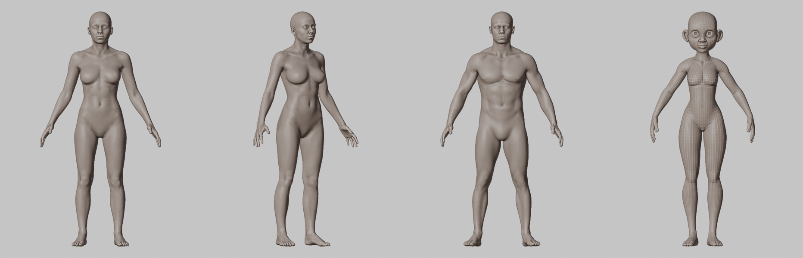
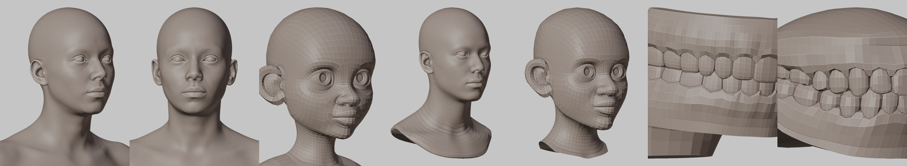
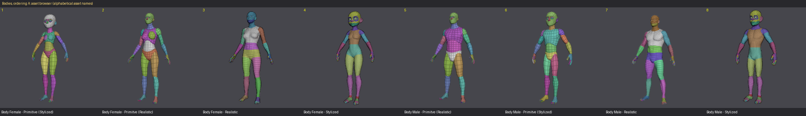
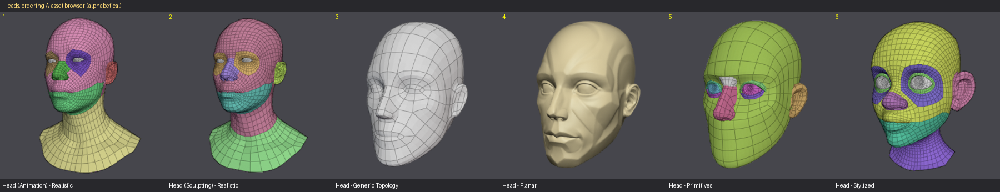
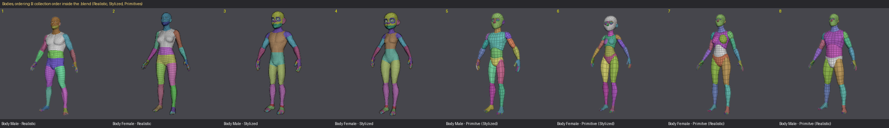
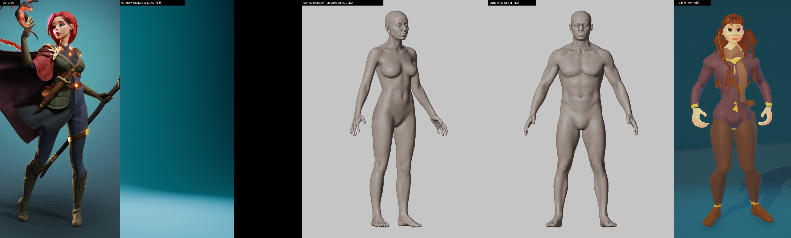
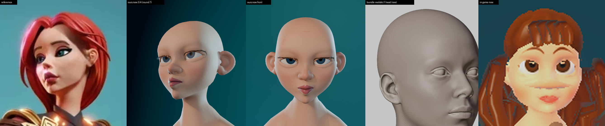
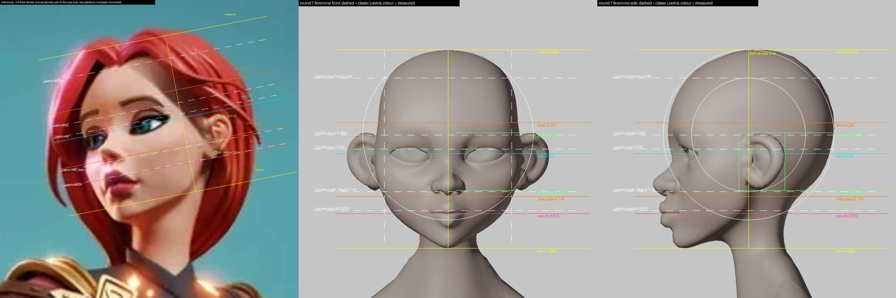

# G9: characters that look like the reference (face and body)

> **Stopped 2026-11-26 (user).** The Unity characters and look work (G8, G9) is stopped. This page is kept as a record; don't build from it unless the user starts it again.

Build guide for the agent that executes it. Scope: the naked person (face, head, body, eyes, lashes, brows, teeth, hair,
beards) and its hand-off to Unity. Clothes are a separate plan afterwards; section 9 lists what the body must provide for them.
Written 2026-11-16 by the planner from measurements and inspection. Reviewed the same day against the scripts, the source
file and the Unity code; the changes from that review are listed in section 12.

**Status (2026-11-16, 16:00).** WP0 is mostly done already: `legacy_stylised/` exists, `extract_source.py` is rewritten and
`source/human_base_realistic.blend` (29 MB, the 15 objects of WP0, checked) is in place. Left of WP0: update `CREDITS.md`,
delete the two empty folders `legacy_stylised/legacy_stylised` and `legacy_stylised/source`. Nothing else has started.

- Look: `roadmap/game/plans/g8-art-direction.md`. Target image: the user's reference (a stylised 3D fantasy mage by another
  artist). Match its style, proportions and render quality for our own varied townsfolk. Never recreate that character
  (no red bob + mage outfit + dragon combination in any preview or default).
- Pipeline: `art3d/characters/` (Blender 4.3, headless: `B=/Applications/Blender.app/Contents/MacOS/Blender`, `$B -b -P script.py`).
- Rules: reuse free resources first (CC0 preferred, CC-BY with credit, no logins or captchas, licence verified, entry in
  `CREDITS.md`); 8 GB RAM; deterministic re-runnable scripts; Unity Humanoid; do not commit; the start town has no fixed name (use no place names in previews or docs).
- Evidence made for this plan: `art3d/characters/previews/compare/plan/` (called `PLAN/` below).
- **The reference image is not in the repository** (only `previews/compare/reference_face_crop.png` and the gridded
  enlargements in `PLAN/` are). Before WP1 the user puts the full image (1140 x 1244) at
  `art3d/characters/previews/compare/reference.png`; `compare.py` reads it from there by default. It is another artist's
  work: keep it out of git (add the path to `.gitignore`) and out of anything we ship.
- "scratchpad" in this plan means the scratch folder of the planner's own session, which a later session cannot see. Treat
  every such path as "may be gone"; each place it is used names what to do instead.
- **Mannequin rule.** The scan bodies have nipples and a modelled groin. Our body is a smooth mannequin: WP3 removes both on
  both sexes, and no key (including `Child`) may bring them back. Preview sheets of the `Child` key show the head and a
  clothed or silhouette body only. In game nobody is ever drawn undressed: see section 6, step 6.
- **Splitting the work.** One Blender or Unity job at a time (8 GB), so the packages run in order. Work that needs no Blender
  run can be written in parallel by a second agent and integrated by the coordinator: the hair generator rewrite (WP8, needs
  only the landmark names of WP2), `transfer.py` (WP3) and the `PersonRecipe.cs` change (section 6).

## 0. Bundle picks (confirmed by the user 2026-11-16: reading S)

**Confirmed.** The user meant the planner's strips: realistic female and realistic male bodies in, stylised female out.
WP2 may start. Readings A and B below are kept only as a record.

The user said: "in bundle bodies i want 1, 2 and 3 and not the last one, and in heads i don't want the over stylized one".
The bundle (Blender Studio Human Base Meshes v1.4.1, CC0) has 8 body assets and 6 head assets, so "1, 2, 3 and not the last"
does not fit the bundle's own lists well. It fits exactly the two strips the planner rendered while writing this plan
(4 body panels, 7 head panels). **The plan assumes the user was numbering those strips (reading S below).** All three readings
are shown so the coordinator can confirm; section 0.4 says what changes under each.

### 0.1 Reading S (assumed): the planner's strips

`PLAN/bundle/planner_strip_bodies.png`, left to right:

| # | Shown | Bundle object | Pick |
|---|---|---|---|
| 1 | realistic female, front | `GEO-body_female_realistic` | yes |
| 2 | realistic female, 3/4 (same mesh as 1) | `GEO-body_female_realistic` | yes |
| 3 | realistic male, front | `GEO-body_male_realistic` | yes |
| 4 (last) | stylised female, front (our current base) | `GEO-body_female_stylized` | **excluded** |

`PLAN/bundle/planner_strip_heads.png`, left to right: 1 and 2 the head of the realistic female body (3/4, front); 3 the head
of the stylised female body (bug eyes, **the over-stylised one, excluded**); 4 `GEO-head_animation_realistic`;
5 `GEO-head_stylized` (also stylised: treated as excluded, see 0.4); 6 `Jaw - Stylized`; 7 `Jaw - Realistic` (teeth sets).

### 0.2 Reading A: asset browser order (alphabetical asset names)

Thumbnails are the bundle's own (`PLAN/bundle/<file>.png`); sheets: `bodies_order_A_asset_browser.png`, `heads_order_A_asset_browser.png`.

| # | Body asset (collection) | Main object(s) | What it is | Thumbnail |
|---|---|---|---|---|
| 1 | Body Female - Primitive (Stylized) | 51 `GEO-*_female_primitive_stylized` objects | separate subdivision blobs per body part, a sculpting block-out, not one mesh | `primitive_body_female_stylized.png` |
| 2 | Body Female - Primitve (Realistic) | 50 `GEO-*_primitive_female_realistic` objects | same, realistic proportions | `primitive_body_female_realistic.png` |
| 3 | Body Female - Realistic | `GEO-body_female_realistic` (+ `.eye.L/.R`) | scan-based, 10,582 verts / 10,590 faces, Multires 3, 102 face sets, 1.64 m | `realistic_body_female.png` |
| 4 | Body Female - Stylized | `GEO-body_female_stylized` (+ eyes) | "Rain" topology, 12,502 verts, 42 face sets, cartoon head; **our current base** | `stylized_body_female.png` |
| 5 | Body Male - Primitve (Realistic) | 49 objects | block-out | `primitive_body_male_realistic.png` |
| 6 | Body Male - Primitve (Stylized) | 49 objects | block-out | `primitive_body_male_stylized.png` |
| 7 | Body Male - Realistic | `GEO-body_male_realistic` (+ eyes) | same topology and vertex indices as the female realistic body, 1.69 m | `realistic_body_male.png` |
| 8 (last) | Body Male - Stylized | `GEO-body_male_stylized` (+ eyes) | "Snow" topology, same as the stylised female | `stylized_body_male.png` |

| # | Head asset | Main object(s) | What it is | Thumbnail |
|---|---|---|---|---|
| 1 | Head (Animation) - Realistic | `GEO-head_animation_realistic` + `.iris.L/R`, `.sclera.L/R` | 3,242 verts, Multires 1, loops made for rigging, separate iris and sclera | `realistic_head_anim.png` |
| 2 | Head (Sculpting) - Realistic | `GEO-head_sculpting_realistic` + iris, sclera | 3,307 verts, even quads for sculpting | `realistic_head_sculpt.png` |
| 3 | Head - Generic Topology | `Head - Generic Topology` | 318-vert cage with shape keys `Real_MALE`, `Real_FEMALE`, `Real_Kid`, `Toon_MALE`, `Toon_FEMALE`, `Toon_Anime_Kid`, `Toon Animal`, `Ork`, `Suzanne` | `primitive_head_generic.png` |
| 4 | Head - Planar | `Head - Planar` | 318 verts, Multires 5, face reduced to clean planes | `planar_head.png` |
| 5 | Head - Primitives | 11 `GEO-*_primitve` objects | block-out pieces | `primitive_head_realistic.png` |
| 6 | Head - Stylized | `GEO-head_stylized` (+ eyes) | 4,118 verts, cartoon head with very large round eyes and ears | `stylized_head.png` |

### 0.3 Reading B: collection order inside the .blend

Bodies: 1 Body Male - Realistic, 2 Body Female - Realistic, 3 Body Male - Stylized, 4 Body Female - Stylized, then the four
primitive sets (5 Male Stylized, 6 Female Stylized, 7 Female Realistic, 8 Male Realistic). Heads: Head (Animation) - Realistic,
Head (Sculpting) - Realistic, Head - Planar, Head - Stylized, Head - Generic Topology, Head - Primitives.
Sheets: `bodies_order_B_file_collections.png`, `heads_order_B_file_collections.png`.

### 0.4 What each reading changes

| Reading | Bodies in | Bodies out | Effect on this plan |
|---|---|---|---|
| S (assumed) | Female Realistic, Male Realistic | Female Stylized (and with it the stylised family) | the plan as written |
| A | Female Primitive (Stylized), Female Primitive (Realistic), Female Realistic | Male Stylized | carrier is still the realistic pair (the male realistic body is needed for `Sex`; ask the user); primitives are block-outs and can only serve as proportion guides |
| B (four full bodies) | Male Realistic, Female Realistic, Male Stylized | Female Stylized | as written, plus `GEO-body_male_stylized` allowed as an optional shape donor (at most 25 %) for the masculine stylise field; never as topology |

Under every reading the stylised female body (today's base) is not picked and the realistic female body is, so the central
decision (rebase on the realistic bodies) holds. Heads: `Head - Stylized` is the most stylised head asset and the stylised
bodies' own heads are more extreme still; the plan uses neither. If the user says `Head - Stylized` is fine, it may be added as
one more donor for `Eye_Big`/`Eye_Round` only (WP3), nothing else changes.

Reading S was confirmed by the user on 2026-11-16; nothing is waiting on this any more.

## 1. Measured gap analysis

Method. Reference: pixel landmarks picked by hand on gridded enlargements (`PLAN/ref_face_grid.png`, `PLAN/ref_body_grid.png`),
stored in `PLAN/reference_landmarks.json` (face about +-2 px, body about +-6 px; the head is 103 px tall, so one pixel is 1 % of a
head). The figure is clothed, posed (wide stance, head turned about 35-40 degrees and tipped back) and seen from a low camera, so
body values carry about +-8 % and are corrected for pose where noted. Ours: measured exactly on `base.blend` in rest pose with
`PLAN/measure_ours_3d.py` (dense surface slices; output `PLAN/ours_3d_measure.json`). Candidate base: the bundle's realistic
bodies, `PLAN/measure_bundle_realistic.py` (output `PLAN/bundle_realistic_measure.json`). In game: read off `PLAN/ingame_ref6.png`.
Side by sides: `PLAN/gap_body.png`, `PLAN/gap_face.png`.

### 1.1 Body (widths in head heights unless noted)

| Measure | Reference | Ours F now | Ours M now | Bundle realistic F / M (raw) | In game (ref6, clothed) |
|---|---|---|---|---|---|
| heads tall | 8.5 in image, about 8.3 pose-corrected | 7.69 | 7.50 | 7.43 / 7.38 | about 7.0 |
| head width / head height | about 0.70 | 0.74 | 0.64 | 0.70 / 0.69 | - |
| neck width | 0.35 | 0.39 | 0.56 | - | - |
| neck length, chin to sternal notch | 0.34 (chin lifted) | about 0.36 | 0.36 | - | short, hidden by scarf |
| shoulder width | about 1.45 | 1.75 | 2.26 | 1.58 / 1.64 | about 1.9 |
| waist width | about 0.85 | 0.71 | 1.01 | 1.03 / 1.28 | about 1.24 |
| hip width | about 1.35 | 1.63 | 1.28 | 1.64 / 1.64 | about 1.52 |
| waist / hip | about 0.63 | **0.44** | 0.79 | 0.63 / 0.78 | 0.81 |
| crotch height / height | about 0.47 pose-corrected | 0.483 | 0.491 | 0.464 / 0.451 | about 0.44 |
| knee height / height | about 0.27 | 0.287 | 0.286 | - | - |
| mid thigh / knee / calf / ankle width | 0.78 / 0.50 / 0.55 / 0.33 (trousers, boots) | 0.75 / 0.40 / 0.49 / 0.23 | 0.61 / 0.38 / 0.50 / 0.25 | - | thighs about 0.75, very heavy |
| hand length | about 0.75 (gloved, foreshortened: low confidence) | 0.82 | 0.89 | - | about 0.57 of a larger head, reads as mitts |
| arm, shoulder pivot to wrist / height | not measurable | 0.27 (wrist would hang 4 % of height above the crotch: short) | 0.27 | - | short |

Reading of the table: the reference is a tall fashion figure (small head, about 8.3 heads), narrow shoulders for the head size,
a moderate hourglass (waist/hip 0.63) and realistic limb anatomy. Our feminine body has a larger head, shoulders and hips about
20 % too wide in head units and a waist the stopped agent over-pinched to 15 cm wide (waist/hip 0.44); the forms are toy-like
(no clavicles, knees, calves, wrists), hands are large mittens, feet stubby, arms short. The raw realistic bundle body already
has the reference's waist/hip (0.627 vs 0.63) and anatomy; it needs a smaller head (7.4 to 8.2 heads), narrower shoulders,
waist and hips, slightly longer legs.

**What the targets mean in centimetres (read this before WP3).** All widths are in head heights, and the head itself gets
about 9 % smaller, so the body narrows much more than the head-unit numbers suggest. Feminine neutral at 1.65 m:

| | Scan (raw) | Ours now | Target (section 5.3) | Change from the scan |
|---|---|---|---|---|
| head height | 22.1 cm | 21.4 cm | 20.1 cm | -9 % |
| shoulder width | 34.9 cm | 37.3 cm | 30.2 cm | -14 % |
| waist width | 22.8 cm | 15.2 cm | 17.3 cm | -24 % |
| hip width | 36.3 cm | 35.0 cm | 27.8 cm | -24 % |

So the target is a fashion-figure body about a quarter narrower than a real one, and its waist is only 2 cm wider than the
waist this plan calls over-pinched. That is what the reference measures, but those reference values are the least certain
ones in the plan (clothed, cape over the shoulders, hip hidden, torso turned 20 degrees, +-8 %). Three consequences, all
written into WP3 and section 5.3:
1. **Depth must follow width.** The plan measured front widths only. Narrowing x by 24 % and leaving the front-to-back depth
   alone gives a barrel torso from the side. Chest, waist and hip depth keep the scan's own depth/width ratio.
2. **Limbs must follow the hips.** Two thighs of the scan's width no longer fit under 27.8 cm hips. Thigh, knee, calf, ankle,
   upper arm and forearm keep the scan's own ratio to hip width (thigh, leg) and shoulder width (arm).
3. **The user sees it before more work is stacked on it** (gate after WP3, section 5.7).

`PLAN/gap_body.png`: the "ours now" panel is blank (the render failed). WP1 re-renders it as part of the baseline.

Note on the existing `compare.py`: its `waist_over_hip` is wrong (0.17 in round 1, 0.39 in round 7 against a true 0.44) because it
slices the decimated torso by vertices. WP1 replaces the slicing with the dense sampling of `PLAN/measure_ours_3d.py`.

### 1.2 Face

| Measure | Reference | Ours F now | Ours M now | Comment |
|---|---|---|---|---|
| eye aperture width / head height | about 0.22 | 0.26 | 0.19 | reference eyes are large (real is about 0.13); ours are in range |
| eye aperture height / width | about 0.38 | 0.44 | 0.51 | ours too round and open |
| outer corner tilt | about +10 degrees (upturned, liner wing) | +4.1 | -3.7 | ours flat or drooping |
| eyeball diameter / head height | 0.24-0.26 (see note) | 0.26 | 0.24 | ours bulge because the ball sits too far forward under thin lids, not because it is too big |
| iris diameter / aperture width | about 0.45, top fifth under the lid | 0.39 | 0.49 | ours shows white all round; gaze drifts sideways in renders |
| inner corner gap / eye width | about 0.7 (low confidence) | 0.63 | 0.65 | fine |
| nose width / face width | about 0.22 | 0.26 | 0.36 | ours bulbous, wide bridge |
| nose length / head height | about 0.22 | 0.21 | 0.19 | fine; shape is the gap (small upturned tip) |
| mouth width / face width | about 0.45 | **0.25** | 0.34 | ours about half as wide as it should be (narrower than the nose) |
| lip height / mouth width | about 0.5 (very full, defined cupid's bow) | 0.58 | thin | ours is a tall pinched pout on a tiny mouth |
| lip height / head height | about 0.165 | 0.114 | - | |
| ear height / head height | about 0.21 | 0.29 | 0.34 | |
| ear stick-out / head width, per side | about 0.03 | **0.19** | 0.17 | ours stand out like handles |
| chin width / face width | about 0.30, defined jaw angle | 0.49, no jaw angle | 0.62 | ours is a round toddler face with full cheeks |
| eye line from the crown / head height | about 0.52 | 0.52 | 0.51 | fine |

Note on the eyeball. An earlier draft took 0.19 ("implied" by the reference) and an eyeball radius of 0.42 x aperture width.
That cannot be built: a sphere of diameter 0.84 x aperture is narrower than the opening it has to fill, so the lids could
never touch it at both corners. The ball has to be wider than the opening: radius 0.56 x aperture width (diameter about
0.25 head for F), set deep, with a small caruncle wedge closing the inner corner. See 2.3, WP3 and WP4.

Note on the face numbers. The reference head is turned 35-40 degrees, and the horizontal face ratios (eye, nose, mouth and
chin widths) were read off that turned head without a yaw correction. They are starting values. The check that decides is
the matched-pose image check of section 5.3, which compares like with like.

### 1.2b User feedback on round 7 (overrides the reference where the two differ)

The user on the stopped agent's round 7 (`previews/compare/round7_face.png`): "ears and lips are too big ... I need smaller
ears and wider lips." Round 7 measured (3D for ears and mouth width; lips on `PLAN/round7_lips_grid.png`, front render:
corners 88 px apart, lips 51 px tall, head 449 px) against the targets this plan now uses:

| Measure | Round 7 F | Round 7 M | Reference | **New target F** | **New target M** | Change from round 7 (F) |
|---|---|---|---|---|---|---|
| ear height / head height | 0.289 | 0.336 | about 0.21 | **0.20 +- 0.02** | **0.21 +- 0.02** | 31 % smaller |
| ear stick-out / head width, per side | 0.188 | 0.173 | about 0.03 | **0.03 +- 0.02** | **0.04 +- 0.02** | flat to the head |
| mouth width / face width | 0.247 | 0.337 | about 0.45 | **0.46 +- 0.03** | **0.46 +- 0.03** | 86 % wider |
| mouth width / nose width | 0.97 | 0.93 | about 2.0 | **at least 1.8** | **at least 1.6** | corners reach well past the nostrils |
| lip height (both lips) / mouth width | 0.58 | - | about 0.50 | **0.30 +- 0.04** | **0.25 +- 0.04** | moderate fullness |
| lip height / head height | 0.114 | - | about 0.165 | **0.097 +- 0.012** | 0.08 +- 0.012 | 15 % less tall |

Ears go to the reference's proportion or just under it. Lips: the reference's own lips are taller than round 7's; the user
asked for less tall and wider, so the neutral takes the reference's mouth **width** and a **moderate** fullness below both
round 7 and the reference. Full reference-like lips remain reachable through `Lips_Full` (see WP5).

Surface and render quality, by inspection of `PLAN/gap_face.png`, `parts/previews/random_people_24.png`, `eye_closeup.png`,
`hair_sheet.png`, `PLAN/ingame_ref6.png`, `PLAN/ingame_crowd3.png`:
- Skin: the Blender look-dev stage (`lookdev.py`) is close in lighting (warm key, teal rim, backdrop), but the albedo is blotchy
  and flat, lips desaturated, no clear cheek/nose blush, and the noise bump reads as orange peel. Reference skin is clean and
  smooth, peach with pink blush on cheeks, nose tip and ears, saturated berry lips with a soft highlight, a wide soft terminator.
- Lashes and brows: ours are thin scribbled strand cards. Reference: one solid dark tapered lash mass with a wing, and smooth
  solid tapered brows.
- Hair: reference is a few large sculpted clumps with soft strand grooves, a clean parting and hairline, a broad soft highlight.
  Ours: ball clusters, worm-like tubes, broken zig-zag strips, and stray cards scattered on foreheads and temples.
- Teeth: box teeth poke through closed lips on about a quarter of the random people.
- In game: about 7 heads, wide muscular torso, heavy thighs, large hands, arms held out, flat cartoon decal face, hair tubes.
  Part of that is clothes and animation (out of scope, noted in section 7).

### 1.3 Ranked gaps

1. **Wrong base family.** The stylised "Rain/Snow" meshes are toddler-cartoon bases (ball eyes 5.5 cm across, handle ears,
   round jaw, simplified toy body). Seven rounds of field tweaks by the stopped agent did not move it out of that family. The
   reference is realistic anatomy, gently stylised.
2. **Eyes and lids:** aperture too round (0.44-0.51 vs 0.38), no upturn (+4/-4 vs +10 degrees), bulging eyeballs, no lid
   thickness or crease, no lash mass, wandering gaze.
3. **Lower face and ears (also the user's round-7 feedback):** mouth half the target width (0.25 vs 0.46 of face width) with
   lips too tall for it (height/width 0.58 vs 0.30); ears 0.29 tall and sticking out 0.19 vs 0.20 and 0.03; no jaw angle,
   chin 0.49 vs 0.30, bulbous nose.
4. **Body proportions and anatomy:** 7.5-7.7 heads vs about 8.3; shoulders and hips about 20 % too wide in head units; feminine
   waist/hip 0.44 vs 0.63; short arms; mitten hands; no anatomical landmarks.
5. **Hair, lashes, brows, teeth quality:** strand-card noise and broken chunks instead of clean sculpted masses; teeth through lips.
6. Skin texture and shading polish (albedo zones, lips, blush, bump strength), in Blender and in the Unity shader settings.
7. In game only: clothes bulk, idle arm pose, 7-head read (follow-up plan; listed so they are not mistaken for body faults).

## 2. Approach

### 2.1 Base mesh: rebase on the bundle's realistic bodies (picked bodies 1-3)

`GEO-body_female_realistic` and `GEO-body_male_realistic` become the carrier topology.
- They are already in hand (CC0, same bundle, same credit) and are the bodies the user picked.
- Verified by the planner: both have 10,582 verts / 10,590 faces (10,570 quads, 20 triangles), **identical vertex indices**
  (every polygon has the same vertex set in both; only the loop start differs; normalised position difference by index below
  5 %), one closed manifold island including an inner mouth, 102 sculpt face sets that outline head+neck, eye surrounds, nose,
  ears, mouth, torso, abdomen, pelvis, upper arms, forearms, palms, every phalange, thighs, shins, feet and toes, and a
  Multires level 3. So `Sex` stays the exact male-to-female difference, seams and joints can again come from face-set
  borders, and the scan detail can be baked.
- Their raw numbers are already near the reference where ours are far (waist/hip 0.627, shoulder 1.58, real hands, feet,
  knees, clavicles, a real jaw, ears 0.245, flat to the head).
- The stylisation the reference has on top of realism (larger eyes, fuller lips, small nose, small head, long legs, smooth
  simplified forms) is added by script (WP3), with artist-made donors from the allowed heads.

Rejected:
- Keep the stylised topology and shrinkwrap it onto the realistic body. Nearest-surface projection between a cartoon head and
  a real one folds at lids, lips, ears and fingers; the stylised eye loops are built for ball eyes; it keeps a mesh the user
  excluded.
- Sculpt-by-script only on the stylised mesh. That is what rounds 1-7 did; see `previews/compare/round7_face.png`.
- MakeHuman / MPFB2 base mesh (CC0 assets, base.obj and targets are plain files in
  `github.com/makehumancommunity/mpfb2/tree/master/src/mpfb/data`). Good morph library, but a third topology, bland faces that
  still need the same stylise pass, helper geometry to strip, and no advantage over the picked bodies. Its **targets are used
  as donors** for age (WP5).
- Quaternius Universal Base Characters (CC0, August 2025, `quaternius.com/packs/universalbasecharacters.html`): whole low-poly
  characters on their own rig, no blend-shape system. Not a base; its **20 hairstyles are the first hair source** (WP8).

### 2.2 How bodies 1-3 and the allowed heads combine

| Source (bundle object) | Role | Where |
|---|---|---|
| `GEO-body_male_realistic` | carrier topology and masculine neutral (`Sex` 0); joints from its face-set borders | WP2 |
| `GEO-body_female_realistic` | feminine neutral: `Sex` = female minus male per vertex, after both went through the same warp | WP2 |
| heads of those two bodies | the face we ship: lids, lips, inner mouth, ears, nose (face sets 17, 2, 3, 4, 5, 7, 8, 22) | WP2, WP4 |
| their Multires level 3 | subtle normal detail for the head texture set (lips, lids, ears, nostrils), at low strength | WP7 |
| `Head - Generic Topology` (318-vert cage with shape keys) | artist-made directions, transferred to our head: **stylised detail** `Toon_FEMALE - Real_FEMALE` and `Toon_MALE - Real_MALE` (larger eyes, smaller nose and chin, softer skull) for the neutral stylise pass and `Eye_Big`; `Real_Kid - Real_FEMALE` for `Child`; `Ork - Real_MALE` for `Species_Orc`; `Toon_Anime_Kid` at low weight for halfling children | WP3, WP5, WP6 |
| `Head - Planar` (Multires 5) | **simplification target**: blending 10-20 % towards it gives the clean cheek, jaw and brow planes of the reference without sculpting | WP3 |
| `GEO-head_animation_realistic` + `.iris`, `.sclera` | **realistic detail**: reference for lid and lip loop placement when checking the face rig; its separate sclera and iris meshes are the eyeball source (scaled up) | WP4 |
| `GEO-head_sculpting_realistic` | not needed (same scan as the animation head on a sculpting topology); listed as allowed, unused | - |
| `Head - Primitives`, body primitives | not used (block-outs) | - |
| `Jaw - Realistic` (5,058 faces, 32 face sets = teeth and gums) | teeth and gums, decimated; replaces the generated box teeth | WP4 |
| `Eye - Realistic` | fallback eyeball if the animation head's sclera/iris pair is awkward | WP4 |
| `GEO-body_*_stylized`, `GEO-head_stylized`, `Jaw - Stylized`, `Eye - Stylized` | **excluded** (reading B alone would allow the male stylised body as a donor, see 0.4) | - |

Sexes: one topology, `Sex` 0..1 as today. Species: one extra key each on the same topology as today (WP6). Children and elders:
keys (`Child`, `Age_Old`) rebuilt from donors (WP5).

### 2.3 Face parts

- **Eyes:** real eyeball geometry enlarged to fit the stylised aperture: sclera sphere plus recessed iris disc (the stopped
  agent's `make_eye_hd`, re-sized, at most 400 tris per eye), radius 0.56 x aperture width (0.54-0.60 allowed), centre deep
  enough that the corneal apex stands at most 0.02 head heights in front of the upper-lid margin; a caruncle wedge (pink,
  at most 24 tris, part of `Mesh_Head`) fills the inner corner where the lids leave the ball. Iris textures: keep the 30
  painted irises (`tex_gen.py`). Cornea shell: keep in `base.blend` for Blender renders, **not exported** (Unity skips it and
  uses `_EyeGloss`). Gaze: eye bones rest looking straight ahead; the look-dev poses converge them on the camera.
- **Lids:** real lid loops from the realistic head, enlarged and reshaped by the stylise pass (almond, +8 to +10 degree tilt,
  visible upper-lid fold). `Eye_Blink_L/R` and the lid shape keys from the existing face rig.
- **Lashes:** a solid dark wedge, not strand cards: a tapered strip extruded from the upper lid margin (thickness 1.2 mm at the
  root, 0 at the tip), with an outer wing, plus a thin lower line; smooth-shaded matte near-black, alpha only at the tips. Six styles keep
  the existing object names (`Part_Lashes`, `_Full`, `_Sparse`, `_Long`, `_Wing`, `_Short`) and manifest fields.
- **Brows:** smooth painted decals again (tapered, soft edge, tinted by hair colour, slight darker core), 30 styles from
  `specs.BROWS`, on the face decal UV at 1024 px. The brow card meshes are dropped (they read as scribbles and cost tris). The
  brow ridge itself is geometry, so brows still catch light.
- **Lips and mouth:** wide, moderately full by default (1.2b); real lips with the slit and the inner mouth bag of the realistic head; Jaw bone opens them (existing
  harmonic "lowerness" weights). Teeth and gums from `Jaw - Realistic`, decimated to at most 700 tris, upper set on Head, lower on
  Jaw, placed inside the mouth bag with no triangle crossing the lips or the bag, and covered by at least 2.5 mm of lip
  (measured to the outer lip skin) in every closed-mouth shape; tongue generated (at most 150 tris). The six
  teeth styles (`even`, `gap`, `fangs`, `broken`, `small`, `buck`) become edits of that set.
- **Noses, ears:** small flat ears by default (1.2b); both stay swappable parts cut along face sets 7 and 4/5 with locked boundary loops, 30 variants each from the
  existing displacement generator (`parts/build_nose_ear.py`), retuned on the new shapes.

### 2.4 Skin texture

Keep the stopped agent's layout and Unity contract: head, nose and ears on their own 0..1 layout in `UVMap`, the legacy face
decal rectangle in the second layer `FaceDecalUV` (Unity wires the skin set only when the head has that second UV).
Head set = painted albedo per skin tone (clean base, soft blush on cheeks, nose tip, ears, chin; cooler eye sockets; lip colour
from `head_lipmask`), normal = Multires bake at 0.35 strength plus lip lines (no pore noise above 0.1), roughness (lips and lids
glossier), AO, cavity. Ship 1024 px (2048 only for portraits). Body stays untextured: skin tint plus vertex-colour blush on
knuckles, elbows, knees, collarbones (the shader's plain-body mode). No photo skin textures are needed; ambientCG has no usable
CC0 skin set (checked: `ambientcg.com/a/Skin001` does not exist).

### 2.5 Hair and beards

Sculpted clumps, as in the reference: a scalp cap that follows the hairline exactly, plus 6-40 large tapered locks with a lens
cross-section, strand grooves from a tiling normal/tint map (no alpha on the mass). Alpha cards only as an optional thin fringe
along the hairline and for wisps at lock tips, never scattered over skin. Sources, in this order:
1. Quaternius Universal Base Characters hairstyles (20, CC0): download without login from the pack page (direct download or the
   itch.io "No thanks, just take me to the downloads" path; if it needs an account, skip), fit each to our head by landmark RBF,
   re-normal, add grooves.
2. Our generator, rewritten around guide curves (WP8), to reach 30 and for every style Quaternius lacks (braids, buns, tonsure,
   elder, dreadlocks, curls as overlapping clumps instead of balls).
3. Optional later: MakeHuman Hair 01 (CC0, `files.makehumancommunity.org/asset_packs/hair01/hair01_cc0.zip`, 228 MB; card-based
   realistic hair fitted to the MakeHuman head, needs the same RBF fit). Hair 02/03 are CC-BY. Not needed for the reference look.
Beards: same clump method on the jaw surface, with painted stubble decals for the short ones.

### 2.6 Keeping the 30-variant part sets and all blend shapes

- Every blend shape is still a displacement field in the virtual T-pose space (`shapes.py` + `fieldmap.py`), which does not
  depend on topology. The rebase re-evaluates them on the new vertices; fields with hard-coded heights (eye 1.6325, nose 1.585,
  mouth 1.5676, ...) are re-anchored to named landmarks first (WP5). Names and count stay: 18 body + 41 face + 4 species + 12
  expression = 75 keys on the welded mesh (the README's "63" predates the 12 expression keys).
- "Neutral" is not what the game shows. `PersonRecipe.cs` gives every woman `Lips_Full` 0.2-0.85 and `Eye_Big` 0.15-0.75,
  every man `Brow_Ridge` and `Shoulders`, everybody `Ears_Back` 0-0.4, and so on: several keys are always on. The targets of
  section 5.3 must hold for the **average generated person**, not only for the all-zero neutral, or the user's "lips too big"
  comes straight back in game. WP5 measures the generated population and section 6 re-centres the recipe.
- Parts are generated from the body surface and carry weights and keys by transfer from the nearest body vertex, as today, so
  they regenerate. `parts_manifest.json` keeps ids, categories, sockets and texture conventions; counts stay 30 per category.
- Hard-coded head geometry in `parts/gen.py` (`HC`, `TOP`, the SDF ellipsoids) is replaced by values read from
  `base_body_meta.json` landmarks.

### 2.7 Triangle and memory budgets

| Item (LOD0) | Budget | Today |
|---|---|---|
| `Mesh_Head` incl. neck and mouth bag | 7,000 | 6,624 |
| `Part_Nose` / each ear | 500 / 500 | 524 / 488 |
| `Mesh_Torso` / `Mesh_Arms` / `Mesh_Hands` / `Mesh_Legs` / `Mesh_Feet` | 2,400 / 1,600 / 2,600 / 2,600 / 1,400 | 1,334 / 1,276 / 1,848 / 2,256 / 1,542 |
| each eye (sclera + iris) | 400 | 1,408 + 416 cornea |
| lashes | 300 | 756 |
| teeth + gums + tongue | 900 | - |
| body skin total with eyes, lashes, mouth | **21,000** | about 20,900 |
| hair: short / long | 2,500 / 5,000 | uncontrolled (`parts_hair.fbx` is 64 MB) |
| beard | 1,500 | - |
| whole dressed person (hidden skin removed) | 35,000 | - |

File budgets: `base_body.fbx` at most 12 MB, `parts_hair.fbx` at most 25 MB, head textures 1024 px. Blender: one instance at a
time, Multires level 3 only inside the bake step (about 680k faces, under 1.5 GB), Cycles bakes on CPU at 1024 px and 16 samples
while iterating. Do not run a bake while the Unity editor is importing.

## 3. What the stopped agent left, and what to do with each piece

Its session ran 10:51-11:55 on 2026-11-16 (file times). It kept the stylised base, exported the stylised head at full
resolution, built a face rig, a skin texture set, HD eyes, lash and brow cards, hair cards, a look-dev stage and a compare loop
(7 face rounds, 3 body rounds; `report.md` was never written). The pre-rework pipeline is in the session scratchpad
(`scratchpad/backup/characters`, may vanish).

| Piece | Verdict | Action |
|---|---|---|
| `lookdev.py` (EEVEE stage: warm key, teal rim, gradient backdrop, SSS skin, eye and card materials) | **keep** | the render stage for every comparison; fix gaze and backdrop framing in WP1 |
| `compare.py`, `compare_img.py`, `previews/compare/round*` | **keep, fix** | fix slicing (waist bug), add the metrics and score table of section 5; old rounds stay as history |
| `face_rig.py` (topological search for lip contact loops and lid margins, harmonic lowerness field for Jaw weights, expression deltas) | **keep, re-fit** | algorithm is sound and verified (jaw opens, blinks close); re-run on the realistic head, adjust the loop finders (WP4) |
| `head_build.py: head_uvs` (own head layout in `UVMap`, legacy rect in `FaceDecalUV`) | **keep** | Unity's `BuildSkinSet` depends on it |
| `head_build.py: make_eye_hd` | **keep, shrink** | at most 400 tris per eye; cornea stays in the blend only |
| `head_build.py: make_lashes`, `export/textures/lashes/*` | **replace** | solid wedge lashes (2.3); keep object names and manifest keys |
| `skin_tex.py` (helper bakes, per-tone albedo, normal, roughness, AO, cavity, lip mask, `skin_tones.json`) | **keep, retune** | cleaner albedo, weaker bump, Multires normal mixed in, 1024 output (WP7) |
| `tex_gen.py` iris painter and `parts/export/textures/eyes_hd` | **keep** | |
| `tex_gen.py` lash, brow and hair strand painters; `parts/build_brows.py` (cards); `textures/brows_hd` | **drop** | brows return to decals (`parts/decals.py`), strand map reused only as the hair groove map |
| `parts/cards.py` (cards scattered over hair and beard shells) | **drop** | source of the strips on foreheads; hairline fringe is rebuilt in WP8 |
| `parts/build_hair.py`, `build_beards.py`, `gen.py` | **rewrite** | clump method (WP8) |
| `parts/build_mouth.py` (box teeth, cavity fit from `faceRig` meta) | **replace teeth, keep placement logic** | bundle teeth, clearance test |
| `common.EXPR_SHAPES` (12 expression keys), meta fields `expressionShapes`, `faceRig`, `faceLandmarkVerts`, `eyeParts`, `headUv` | **keep** | part of the contract now |
| `verify_face.py` | **keep, extend** | add the clearance, gaze and budget checks |
| `source_mesh.py` round 1-3 proportion edits, `shapes.py` and `species.py` edits of 11:30-11:42 | **superseded** | the warp mechanism (`FRAC`, `make_warp`) is kept; numbers are re-derived; the over-pinched feminine waist goes |
| full-resolution stylised head in `base.blend` / `base_body.fbx`, stylised ball eyes | **drop** | replaced by the realistic head |
| Unity edits it made (`CharacterImport.BuildSkinSet`, `_SKINMAPS` in `CharacterLit.shader`, `PersonFace.cs`, `uv2` in `PartLibrary`/`PersonBuilder`) | **keep** | they are the contract this plan exports to |
| `base.blend1`, `parts/parts.blend1` | delete at the end | 145 MB of backups |

## 4. Work packages (in order)

Every package ends with: rebuild, run the verify scripts, run the comparison of section 5 with a new round number, append a row
to `previews/compare/report.md`. A package is done when its acceptance numbers pass. Effort is agent working time.

### WP0. Safety copy and sources (0.5 h) — mostly done, see Status at the top
- **Also back up Unity now.** `unity/` and `art3d/` are untracked in git, so there is no way back from a bad import. Copy
  `unity/GardenOfEden/Assets/Game/Art/People/` (with its `.meta` files) to `unity/GardenOfEden/_backup/People_pre_g9/`
  (outside `Assets`, so Unity ignores it) and keep today's `export/` and `parts/export/` FBX files in
  `art3d/characters/legacy_stylised/export_fbx/` (about 105 MB) until the clothes plan has passed.
- Copy today's scripts and JSON exports (no `.blend`, no FBX) to `art3d/characters/legacy_stylised/` with a three-line README.
- Bundle zip (only needed if the extraction must be redone): the planner's copy was in its own scratch folder; download
  `https://mirror.blender.org/demo/asset-bundles/human-base-meshes/human-base-meshes-bundle-v1.4.1.zip` into a new empty
  scratch folder (untrusted archive: scripts elsewhere, `python3 -I`).
- Rewrite `extract_source.py` to write `source/human_base_realistic.blend` containing only: `GEO-body_male_realistic`,
  `GEO-body_female_realistic` (with Multires and `.sculpt_face_set`), their eyes, `GEO-head_animation_realistic` with iris and
  sclera, `Head - Generic Topology` (with shape keys), `Head - Planar`, `Jaw - Realistic`, `Eye - Realistic`. Look objects up by
  name with spaces stripped (the bundle has names like `Hand  - Realistic` and `Jaw - Stylized ` with odd spacing). Keep
  `source/human_base_stylized.blend` until WP9 passes, then remove it.
- Acceptance: file exists, under 40 MB, lists exactly those objects; `CREDITS.md` updated (same bundle, new object list).

### WP1. Comparison harness and baseline (1 h)
Also write `loomis_overlay.py` (spec in section 11.5) here, and include its rows in the baseline round.
- `compare.py`: replace `measure()` with the dense-slice measures of `PLAN/measure_ours_3d.py` (all keys of
  `ours_3d_measure.json`, plus `lip_h_over_mouth_w`, `arm_len_over_height` from the shoulder pivot, `wrist_hang_vs_crotch`);
  read targets and tolerances from a new `art3d/characters/compare_targets.json` (section 5.3); write
  `previews/compare/measure_round<N>.json` and append the score table to `previews/compare/report.md`.
- Add the render set of section 5.1 (`ref_body`, `ref_face`, `front_face`, `front_body`, `side_body`) and composites against the
  reference and against the previous round.
- `lookdev.py`: eye bones converge on the camera in face shots; backdrop gradient centred behind the figure.
- Copy the Unity shot helpers from `PLAN/unity_shots/` to `art3d/characters/tools/unity_shots/` and replace their hard-coded
  scratch paths with arguments.
- Run it once on today's `base.blend` as **round 8 = baseline**. Acceptance: `report.md` exists with the baseline table, and its
  numbers equal `PLAN/ours_3d_measure.json` within 0.01.

### WP2. Rebase `source_mesh.py` on the realistic bodies (3 h)
Inputs: `source/human_base_realistic.blend`. Change `source_mesh.py`, `build_base.py`, `common.py`, `fieldmap.py`, `shapes.py`.
- **Staged build.** `build_base.py` is one script that also builds the keys, the face rig, the eyes and the mouth, and those
  are only re-fitted in WP4 and WP5. Add `stage=body|face|all` (default `all`): `body` builds the warp, split, decimation, rig,
  weights, normals and export and skips `face_rig`, `head_build` eyes and lashes and the mouth; `verify_export.py` takes the
  same argument and skips the checks of skipped stages. WP2 and WP3 are accepted on `stage=body`; from WP4 on everything runs
  on `all`.
- **Keys exist from this package on.** Do the mechanical half of WP5 here: replace every hard-coded coordinate in
  `shapes.py` with landmark-relative values (the `LM` object) and re-fit `fieldmap.py` to the new rest pose (the realistic
  bodies hold their arms at a different angle than the stylised ones: measure it from the landmarks, do not keep the old
  constant). All 63 shape keys (body, face, species) then evaluate on the new mesh, untuned. This keeps the 75-name contract
  and `joint_offsets.json` valid for every later package; WP5 only retunes.
- The base-level vertices lie exactly on the Multires surface in this file (checked: 0.00 mm apart, and they are the first
  10,582 vertices of the evaluated mesh), so level 0 loses no volume.
- `load_source()`: read base-level positions (Multires at level 0, not applied), polygons and `.sculpt_face_set` of both
  sexes; assert identical vertex sets per polygon between the sexes.
- `PART_OF_SET`: new map from the 102 face sets. Measured on the female (id: face count, centre): 17 head and neck (2,024);
  2 / 3 eye surrounds (225 each, +x / -x); 4 / 5 ears; 7 nose (190); 8 (100) and 22 (494) lips and inner mouth (identify which is
  the bag by testing which faces are inside the head); 1 chest and shoulders (706); 19 abdomen (128); 18 pelvis (168);
  21 / 20 upper arms; 12 / 11 forearms; 9 / 10 palms; 64-103 finger phalanges; 24 / 23 thighs; 15 / 16 shins; 14 / 13 feet;
  25-63 toes. Render one face-set colour image (`previews/facesets_realistic.png`) and check the map by eye before going on.
- Parts as today: `Mesh_Head` = 17 + 2 + 3 + 8 + 22, `Part_Nose` = 7, `Part_Ear_L/R` = 4 / 5, `Mesh_Torso` = 1 + 19 + 18,
  `Mesh_Arms` = upper arms + forearms, `Mesh_Hands`, `Mesh_Legs` = thighs + shins, `Mesh_Feet`. If the realistic sets put the
  shoulder cap or the neck border elsewhere than the stylised ones, keep the artist's border (it is where the loop is clean)
  and record the seam heights in the meta.
- `landmarks()`: same keys as today (`sole`, `top`, `chin`, `neck_base`, `shoulder_b`, `pivot`, `elbow`, `wrist`, `hip_b`,
  `knee`, `ankle_b`, `ball`, `toe_tip`, `eye`, `eye_r`, `ear`, `nose`, `nose_tip`, `head_c`, `head_half_w`, `palm_end`, ...)
  from face-set border centroids; add `sternal_notch`, `crotch`, `nasion`, `subnasale`, `gonion`, `brow`.
- `make_warp()` targets (`FRAC`, per sex), piecewise-linear in z with head and neck scaled in x/y, as today:

  | | F | M |
  |---|---|---|
  | height | 1.65 m | 1.75 m |
  | heads tall | 8.2 | 8.0 |
  | crotch / height | 0.485 | 0.480 |
  | knee / height | 0.275 | 0.272 |
  | chin to sternal notch / head height | 0.36 | 0.32 |
  | arm: wrist hangs level with the crotch, +-1.5 % of height | yes | yes |
  | hands scale about the wrist | hand length 0.76 head | 0.80 head |

- Decimation: keep `decimate_part` (Decimate COLLAPSE on a face subset with every part-boundary vertex in a locked vertex
  group, `vertex_group_factor` protecting them, then assert the boundary vertices are bit-identical). Also lock the lid
  margins, lip loops, nostril rims and nail borders. Head, nose, ears at ratio 1.0. Choose the other ratios to land on the
  budgets of 2.7 (roughly torso 0.75, arms 0.70, hands 0.55, legs 0.80, feet 0.45 of the base-level tris; tune). Decimate
  the male, map the same topology onto the female through barycentric coordinates on the undecimated male, as today.
- Rig: same 55 bones and names, joints from face-set borders as today; hips, spine, chest from landmarks. Weights: automatic
  weights + 3 smoothing passes (not hands), max 4 influences. Record the rest arm angle in the meta (`restPose.armAngleDeg`).
- Normals: computed on the welded mesh, then frozen as custom split normals on the parts (as today).
- Acceptance: `build_base.py` runs in under 60 s and is byte-stable across two runs (same FBX hash apart from the timestamp
  field: compare `base_body_meta.json` and vertex data); `verify_export.py` passes (55 bones, all Humanoid; seam position,
  weight and shape-delta diffs 0; normals diff under 1e-3); tris within the budgets; measures at this stage: heads 8.2 +- 0.1 (F),
  8.0 +- 0.1 (M), crotch 0.485 +- 0.01, waist/hip 0.60-0.66 (F), 0.76-0.82 (M); pose test sheet (T-pose, arms down, sit, wave,
  fist) shows no collapsed elbows, knees or fingers. The same sheet with the arms raised to a T (what Unity's T-pose
  enforcement does) shows no folded shoulder cap or armpit.

### WP3. Stylise pass (3 h)
Feature placement follows the Loomis grid targets of section 11.3 (apply them in step 2, check with 11.5).
New `stylise.py`, called by `build_base.py` on the welded full-resolution neutral of each sex **before** decimation and before
the keys are evaluated. Everything is a deterministic function of landmarks.
1. Donor transfer helper `transfer_delta(donor_basis, donor_target, our_P, region_weight)` (new `transfer.py`, numpy +
   `mathutils.bvhtree`): (a) fit a polyharmonic RBF (kernel r^3 with an affine term, 30-45 landmark pairs: eye corners, lid
   mids, nasion, nose tip, alar points, subnasale, lip corners and mids, chin, gonion, ear top/bottom/tragus, crown, occiput,
   neck base ring) that maps the donor basis onto our neutral; (b) for each of our vertices find the closest point on the
   warped donor surface (`BVHTree.FromPolygons`, `find_nearest`, reject hits whose normal disagrees by more than 70 degrees and
   take the next ring), interpolate the donor delta barycentrically; (c) push the delta through the RBF's local Jacobian
   (finite differences, 1 mm step); (d) two Laplacian smoothing passes of the delta, multiply by the region weight.
   For the 318-vert cage, subdivide it twice (Subsurf applied to basis and target alike) before the lookup.
2. Face, both sexes (weights are starting values; iterate against section 5):
   - `Toon_FEMALE - Real_FEMALE` (F) / `Toon_MALE - Real_MALE` (M) from `Head - Generic Topology`, weight about 0.45 (F) / 0.30 (M),
     limited to the head above the neck base.
   - Eyes: scale the lid region about each eye centre until aperture width = 0.22 head (F) / 0.19 (M), move centres outward so
     the inner-corner gap = 0.70 eye widths, shape the margin to height/width 0.38 with the upper-lid peak at 40 % from the inner
     corner and the outer corner raised to +9 degrees (F) / +5 (M); deepen the upper-lid fold. Eyeball radius 0.56 x aperture
     width (1.2 note). In this package the eyeball is only a guide sphere (the real one is built in WP4): shape the lids so
     their margins lie on it (gap under 0.4 mm, no penetration, tested by ray casts along the margin) everywhere except the
     inner 12 % of each margin, where the caruncle wedge goes.
   - Nose: width to 0.22 (F) / 0.26 (M) of face width, bridge narrower, tip slightly up (subnasale-tip line +12 degrees F).
   - Mouth (user feedback, 1.2b): width to 0.46 of face width for both sexes, corners at least 1.8 (F) / 1.6 (M) nose widths
     apart; lip height / mouth width 0.30 (F) / 0.25 (M), i.e. lip height 0.097 head (F); defined but shallow cupid's bow;
     corners neutral. Widen by moving the corners and the whole lip loops outward along the dental arch, not by stretching
     the middle (keep vertex spacing even along the lip loops).
   - Jaw and chin: chin width 0.30 (F) / 0.40 (M) of face width, clear gonial angle, flatter cheeks under the cheekbone.
   - Ears (user feedback, 1.2b): scale each ear part about its attachment centre to height 0.20 head (F) / 0.21 (M) and rotate
     it flat until the stick-out is 0.03 (F) / 0.04 (M) head widths; the boundary loop on the head shrinks with it (move the
     head-side loop too, they are welded at this stage).
   - Neck: width 0.35 head (F) / 0.50 (M).
   - Planes: blend the head 15 % towards `Head - Planar`: RBF-fit the planar head (Multires level 3 applied) to our head on
     the same landmarks, move each of our vertices 15 % of the way to its closest point on it, excluding lids, lips, nostrils
     and ears; this sharpens the cheek, jaw and brow planes.
3. Body, both sexes: shoulder width 1.50 head (F) / 2.05 (M); waist 0.86 / 1.15; hips 1.38 / 1.30; waist/hip 0.62 / 0.88 at the
   new head size. **Scale depth with width** (section 1.1): at chest, waist and hip the depth/width ratio stays within 10 % of
   the raw scan's. **Scale the limbs with the trunk**: thigh, knee, calf and ankle widths keep the raw scan's ratio to hip
   width, upper arm and forearm its ratio to shoulder width, each within 8 %, and the two thighs at the crotch are together
   no wider than the hips; the scale blends smoothly across the hip and shoulder seams. WP1 adds these scan ratios to
   `PLAN/bundle_realistic_measure.json`. Remove the nipples and flatten the groin on both sexes (mannequin rule), soften the
   navel. Then a volume-preserving Laplacian smooth (lambda 0.5, 6 passes, face, hands and feet masked out) that moves no
   vertex more than 2 mm: it takes out scan noise, it must not take out the clavicles, knees, calves and wrist bones this
   plan chose the scan for.
4. `Sex` is taken after this pass (female stylised minus male stylised).
- Acceptance (on `stage=body`, bald, guide-sphere eyes, flat skin tint): every face and body row of the score table that
  needs no eyeball or texture within tolerance for the neutral F (`iris_d_over_eye_w` waits for WP4); neutral M within
  tolerance of the M column of `compare_targets.json`; no self-intersection around lids, lips, nostrils (bmesh overlap test
  returns 0); the shape items of the look checklist (mouth, ears, jaw and chin, neck and shoulders, hands, legs and feet) at
  least 1; the matched-pose image check of 5.3 done for body and face. Then **gate 1** (section 5.7).

### WP4. Face rig, eyes, lashes, teeth on the new head (2.5 h)
Change `face_rig.py`, `head_build.py`, `parts/build_mouth.py`, `verify_face.py`.
- `find_face()`: adapt lip-loop and lid-margin detection to the realistic topology (use face sets 8 / 22 and 2 / 3 as search
  regions; use `GEO-head_animation_realistic` only to cross-check that the found loops lie where its lip and lid loops lie).
  Keep `mouth_bag`, `lowerness`, `lid_frames`, `expression_deltas` and the 12 `EXPR_SHAPES`.
- Eyeballs from the animation head's sclera + iris (or `make_eye_hd` re-sized); planar eye UV as in the meta today (iris
  centred, eyeball radius = 0.5 in UV); weights 100 % to the eye bones; eye keys follow the socket as today.
- Lashes: wedge geometry from the lid margin polyline (`faceRig.lidMargins`), six styles, keys by transfer so they blink.
- Teeth: import `Jaw - Realistic`, RBF-fit to the mouth bag (landmarks: lip corners, inner-lip mids, bag back), split upper /
  lower by its face sets, Decimate to at most 350 tris each with the front faces protected, weights Head / Jaw; tongue as today.
- `verify_face.py` adds: teeth clearance (no tooth or gum triangle intersects the lips or the mouth bag; with the mouth
  closed every tooth vertex is at least 2.5 mm behind the outer lip skin; checked in neutral, in every mouth key at weight 1
  and with Jaw at 0 and 12 degrees: teeth may show only through the open slit); lid
  margins meet in `Eye_Blink_*` (gap under 0.3 mm at Sex 0 and 1, and with `Eye_Big`, `Eye_Narrow`, each species key); eyeball
  never pierces a lid in any single eye key at weight 1; per-part tri budgets. The keys are still untuned here (WP2), so
  the key-dependent checks are run again, and must pass, at the end of WP5 and WP6.
- Acceptance: `verify_face.json` all true; `parts/previews/expressions_visemes.png` re-rendered: 16 tiles, no teeth through
  lips, no lid gaps; jaw at 12 degrees opens the lips by 9-14 mm.

### WP5. Blend shapes on the new base, age from donors (3 h)
Face keys move features relative to the Loomis lines within the ranges of section 11.6.
Change `shapes.py`, `fieldmap.py`, `build_base.py`.
- The landmark re-anchoring was done in WP2; this package tunes.
- Rebuild all 18 body and 41 face keys; retune amplitudes so each key at weight 1 gives a clear but plausible change. Keep the
  rule "sum of weights touching one region at most about 2".
- `Eye_Big` = more of the WP3 eye enlargement (from the toon donor); `Eye_Narrow`, `Eye_Round`, `Eye_Almond`, tilt keys act on
  the lid margin frames.
- `Child`: head from `Real_Kid - Real_FEMALE` (generic head) and body **proportions** from the MPFB macro targets
  (`src/mpfb/data/targets/macrodetails/universal-{female,male}-child-averagemuscle-averageweight.target.gz` against the
  `-young-` ones; CC0 assets, plain files on GitHub raw; base mesh `src/mpfb/data/3dobjs/base.obj`; a `.target` is lines of
  `vertexIndex dx dy dz` in decimetres) . Do not push the MPFB body deltas through `transfer_delta`: that helper is fitted on face
  landmarks, and a dense transfer between two bodies in different poses folds at armpits, fingers and groin. Instead apply
  each target to the MPFB base, measure segment lengths and girths (head, neck, trunk, upper arm, forearm, hand, thigh, shin,
  foot) on child and young, and feed the ratios into our own warp and girth fields. Proportions then checked: child about
  6 heads, larger eyes, short limbs. `Age_Old`: MPFB `-old-` minus `-young-` (skin sag at jaw and neck, thinner lips, drooped lids, stoop), plus the
  existing field for posture; body by the same ratio method, face sag by `transfer_delta` on the head only. If the result is
  poor (seam artefacts, more than 3 % volume change in hands or feet), fall back to the existing fields re-anchored. Add MPFB to `CREDITS.md` (name, URLs, CC0 for assets, files used) only if used.
- Ranges re-centred on the new neutral (user feedback, 1.2b). The neutral already sits on the targets, so each key is defined
  as a move away from it, with these end values at weight 1 (F; M scales alike), all measured by `compare.py` in a key sweep:

  | Key | Measure | Neutral | At weight 1 |
  |---|---|---|---|
  | `Mouth_Wide` | mouth width / face width | 0.46 | 0.54 |
  | `Mouth_Narrow` | same | 0.46 | 0.38 (never below; round 7's 0.25 is out of range for every stack) |
  | `Lips_Full` | lip height / mouth width | 0.30 | 0.44 (the reference's fullness is about here to 0.50 with `Lips_Pout`) |
  | `Lips_UpperFull` / `Lips_LowerFull` | upper / lower lip height | 0.42 / 0.58 of the lip height | that lip +35 % |
  | `Lips_Thin` | lip height / mouth width | 0.30 | 0.20 |
  | `Lips_Pout` | lip protrusion; lip height / mouth width | 0.30 | 0.38, width -6 % at most |
  | `Lips_CupidBow` | bow depth / lip height | 0.10 | 0.22 |
  | `Mouth_CornersUp` / `Down` | corner height | 0 | +-2.5 mm, width unchanged |
  | `Ears_Back` | stick-out / head width | 0.03 | 0.00 (pinned); a new negative use is not needed |
  | ear size (part variants, `Species_*`) | ear height / head height | 0.20 | humans 0.17-0.24 across the 30 ear parts; only elf and orc parts and `Age_Old` (+8 %) exceed 0.24 |

  Expression keys keep their own motion (`Mouth_Smile` widens by about 12 %, `Mouth_O` narrows to about 0.30) on top.
  **Population check.** `PersonRecipe.MakeShapes` draws the weights, and several keys are always on (2.6). Write
  `tools/recipe_sweep.py`, a line-for-line port of `MakeShapes` (same ranges and chances; note the source line numbers in a
  comment so the two stay in step), draw 200 adults per sex, apply each stack and measure. Required: the population **mean**
  of every weight-3 face row of 5.3 within one tolerance of its target; no human outside mouth width 0.38-0.54, lip height /
  mouth width 0.18-0.46, ear height 0.17-0.24 (0.26 with `Age_Old`), ear stick-out 0-0.08; report mean, min and max. To get
  there, re-centre the recipe (section 6) rather than bending the keys: an always-on key is a hidden change of the neutral.
- `joint_offsets.json` regenerated as today.
- Acceptance: all 75 key names present and non-empty on the parts they should touch (`verify_export.py`); every key at weight
  1 alone and the 24 random stacks of `render_people.py` are free of self-intersection at lids and lips and keep seam diffs 0;
  the sheets `faces_front_grid.png`, `faces_q34_grid.png`, `variety_grid.png` re-rendered; three age rows (child, adult, elder)
  for each sex read as their age at thumbnail size.

### WP6. Species presets (1.5 h)
Each species head and the child head have their own Loomis departures: table in section 11.6.
Change `species.py`. Same mechanism: one key per species = mix of existing keys plus species-only fields, root scale for
height, part lists in `species_presets.json` (unchanged schema).
- Orc: add `Ork - Real_MALE` from the generic head (transfer) at about 0.7, then the existing mix (brow, jaw, underbite); tusks
  as today, set in the new lower lip.
- Elf: existing mix on the new base (finer jaw, longer neck, +14 degree eye tilt), ears from the generator on the new ear part.
- Dwarf, halfling: existing mixes; keep adult faces; halfling children may use `Toon_Anime_Kid` at 0.2.
- The neutral moved (8 heads, small head, narrow trunk), so the old species deltas no longer land on the old species. Each
  species key is re-derived as "species target minus the new neutral": heights and root scales as in the README table
  (elf 1.95 / 1.84, dwarf 1.30 / 1.23, halfling 1.05 / 0.99, orc 2.05 / 1.93), plus a heads-tall target per species written
  into that table (starting values: elf 8.3, orc 7.5, dwarf 6.0, halfling 6.0). A dwarf that is only a scaled-down 8-head
  human fails.
- Human keeps all species keys at 0 and is the only one scored against the reference numbers; species are scored on the
  checklist and on their own height and silhouette table in the README.
- Acceptance: `species_neutral_front.png`, `species_faces.png`, `species_variety_<id>.png` re-rendered; each species is
  recognisable in silhouette at 128 px; blink and jaw still pass `verify_face.py` with each species key at 1.

### WP7. UVs and skin texture set (2 h)
Change `head_build.py: head_uvs` (only if islands need re-cutting on the new head), `skin_tex.py`.
- UV layers and names unchanged. Body: smart-projected islands in the lower-right quadrant of the shared atlas as today.
- Multires normal: on a copy of the stylised neutral (base-level topology, Multires re-attached: copy the realistic object,
  set its base vertex positions to our stylised positions at level 0 so the tangent-space displacements ride along, check the
  result at level 3 for spikes; if it spikes, use `bpy.ops.object.multires_reshape` from a shrinkwrapped copy or skip the
  Multires source and paint lips/lids only). Bake with `scene.render.use_bake_multires = True`, `bake_type = 'NORMALS'` to the
  head UVs at 1024, mix into the painted normal at 0.35.
- Albedo per tone as today but cleaner: base + low-frequency variation at most 3 % + blush zones + lips from the lip mask
  (saturated, per `palettes.lips`); no speckle. Roughness: skin 0.55, lips 0.30, lid margin 0.35. Bump from noise at most 0.1.
- The bake needs UVs on the Multires copy, and our head UVs live on `Mesh_Head`. The head is kept at decimation ratio 1.0, so
  carry a per-vertex source index (`srcVert`) through the split and copy the head UVs back by it; park every non-head face
  in a zero-area corner of the UV square so it bakes nothing.
- Keep `skin_tones.json` schema (`base`, `bodyColour`, `albedo`). Output 1024 px.
- Acceptance: files present with the same names as today in `export/textures/skin/`; neck seam invisible in
  `seams_closeups.png` (head albedo meets the flat body tint: mean colour difference across the seam under 2/255, **for each of the 7 tones**);
  a new sheet `previews/skin_tones_sheet.png` (7 tones x 2 sexes, face close-up in the look-dev stage): blush and lip colour
  read on the darkest tones as well as on `T2_fair`, no grey or orange cast, rim light visible; look checklist items "skin"
  and "lips" at 2. Every other comparison uses `T2_fair` only, so this sheet is the one place dark skin is checked.

### WP8. Parts: 30 each of eyes, mouths, noses, ears, brows, hair, beards (5 h)
Nose, ear and mouth variants stay inside the Loomis bands of section 11.6; hairlines are placed from the hairline line.
Change `parts/*.py` (lib, gen, specs, decals, build_*), `parts/README.md`.
- Ear set (user feedback, 1.2b): the 30 ears are variations **around the new small default**: human variants between 0.17 and
  0.24 of head height with stick-out 0.00-0.08 head widths (at most 4 of the 30 above 0.06, tagged `rustic`/`comic`); elf ears
  keep the small root and add length backwards and up, not width; no variant re-creates round 7's 0.29 handle ear.
- Mouth set (user feedback, 1.2b): the 30 mouths (lip decals, lip-shape presets, teeth style) are built on the wide neutral:
  preset mouth width 0.40-0.52 of face width, lip height / width 0.20-0.42, at most 5 of 30 fuller than 0.38; lip decals
  repainted for the wide lip UV footprint (the old decals were painted for a mouth half as wide and would smear).
- Read all head dimensions from the base meta. Rebuild noses and ears (locked boundary loops, normals blended to the head at
  the rim), eyes (iris textures unchanged), mouths (lip decals re-registered to the new lips; teeth styles), brows (decals at
  1024 on `FaceDecalUV`), lids/make-up decals, stubble.
- Hair: (1) try the Quaternius hairstyles (2.5); for each: RBF-fit to our head from 12 skull landmarks, push every vertex at
  least 2 mm outside the scalp (BVH signed distance), weights and keys by transfer, groove normal map and vertex-colour shade;
  (2) generator rewrite for the rest: scalp cap = offset copy of the scalp faces inside a hairline polyline per style
  (hairline points defined on the head as landmark-relative curves), thickness 6-25 mm, bevelled edge that sinks 1 mm into the
  skin; locks = lofted lens sections along guide splines (numpy Catmull-Rom, 8-10 rings of 6-8 verts, tapered tip), laid in
  overlapping layers front to back; braids as three intertwined tubes with a low ring count; buns as clump spirals; curls as
  short overlapping locks. No free-floating cards on skin. Vertex colour 'Shade' as today.
- Beards: same on the jaw surface.
- Budgets per 2.7; each hair object reports its tris in the manifest.
- `build_manifest.py`: same schema; remove `browCards` convention, keep `lashes`; update texture paths.
- Acceptance: `verify_parts.py` passes; `random_people_24.png` re-rendered with **zero** of: teeth through lips, cards or hair
  fragments on the face, hair intersecting the ears or face, floating locks, lash scribbles (count each, list in the report);
  `hair_sheet.png` shows 30 distinct, clean styles; `parts_hair.fbx` at most 25 MB.

### WP9. Export, docs, Unity hand-off (1.5 h)
- `build_base.py`, `parts/build_parts.py`, `verify_export.py`, `verify_face.py`, `parts/verify_parts.py` all green from a
  clean run. Rewrite `README.md` (tables: parts, tris, keys, sockets with new positions, species), `parts/README.md`,
  `CREDITS.md` (bundle objects used, Quaternius if used, MPFB targets if used, each with author, URL, licence, download date and
  size, how obtained without login, what we changed).
- Update `roadmap/game/plans/g8-art-direction.md`, "People / Proportions": about 8 heads (adult human 8.0-8.2), small head, as
  measured on the reference; replace "heads slightly large".
- Clothes smoke test (no fixing): the garments are generated and bound to `Body_Welded_Source` by vertex and by nearest
  surface, so they may largely rebuild. Run `clothes/build_clothes.py` and `verify_clothes.py` once against the new base and
  write what passes, what breaks and which hard-coded heights `pieces.py` holds into `report.md`, as input for the clothes
  plan. `clothes_lib.py` still says "63 shape keys": garments must also carry the 12 expression keys near the face (hoods,
  collars) or state why not.
- Gate 2 (section 5.7), then run section 6. Then section 5 one last time as the final round and write the closing summary in `report.md`.

Total: about 25 h of agent time (23 h plus the staged build, the population sweep and the clothes smoke test); WP2-WP4 are
the critical path. The two user gates add waiting time, not work.

## 5. Comparison protocol (every iteration)

### 5.1 Renders (EEVEE through `lookdev.py`, neutral human, tone `T2_fair`, bald unless noted)
| Name | Subject | Pose | Camera | Size |
|---|---|---|---|---|
| `ref_body` | F | "reference stance": legs abducted about 17 degrees each, weight on the back leg, torso yaw 20 degrees to camera right, head yaw 38 degrees to her right, pitch back 12, roll 8; her right arm raised (upper arm 60 degrees out and forward, elbow 110), left arm down and out 35 degrees. Stored as bone rotations in `compare.py: POSE_REF` | 50 mm, low: camera height 0.55 x height, distance so the figure fills 72 % of the frame height, azimuth -22 | 1140 x 1244 |
| `ref_face` | F | same head pose | 85 mm, framing as the reference crop (500,180)-(680,360) | 720 x 720 |
| `front_face`, `q34_face` | F and M | rest | 85 mm, level | 680 x 720 |
| `front_body`, `side_body` | F and M | rest (A-pose) | orthographic | 700 x 1244 |
| `ref_body_dressed`, `ref_face_hair` | F with a generated bob-length hair of a **different** colour and parting than the reference, default brows and lashes | as `ref_*` | as `ref_*` | from WP8 on |

Lighting and backdrop: the look-dev stage as is (warm key from camera left and above, teal rim from behind right, dark teal
gradient backdrop, soft contact shadow). Do not change it between rounds; if it must change, re-render the baseline.

### 5.2 Composites (Pillow via `compare_img.py`)
`round<N>_body.png` = reference | `ref_body` | previous round; `round<N>_face.png` = reference crop | `ref_face` | `front_face` |
previous round; `round<N>_overlay_face.png` = `ref_face` at 50 % over the reference crop, aligned on the two eye centres.
Look at every composite before scoring.

### 5.3 Score table (`compare_targets.json`; ours measured in 3D rest pose; g = |ours - target| / tolerance)

| Metric | Target F | Tol. | Target M | Weight |
|---|---|---|---|---|
| heads_tall | 8.2 | 0.2 | 8.0 | 3 |
| shoulder_w_over_head_h | 1.50 | 0.08 | 2.05 | 2 |
| waist_w_over_head_h | 0.86 | 0.06 | 1.15 | 2 |
| hip_w_over_head_h | 1.38 | 0.08 | 1.30 | 2 |
| waist_over_hip | 0.62 | 0.04 | 0.88 | 3 |
| crotch_over_height | 0.485 | 0.012 | 0.480 | 2 |
| neck_w_over_head_h | 0.35 | 0.03 | 0.50 | 1 |
| neck_len (chin to notch) / head_h | 0.36 | 0.04 | 0.32 | 1 |
| hand_len_over_head_h | 0.76 | 0.05 | 0.80 | 2 |
| wrist hang vs crotch / height | 0.00 | 0.015 | 0.00 | 1 |
| eye_w_over_head_h | 0.22 | 0.015 | 0.19 | 3 |
| eye_h_over_w | 0.38 | 0.04 | 0.36 | 3 |
| eye_tilt_deg | 9 | 3 | 5 | 2 |
| iris_d_over_eye_w | 0.45 | 0.04 | 0.45 | 2 |
| inter_over_eye_w | 0.70 | 0.08 | 0.80 | 1 |
| nose_w_over_face_w | 0.22 | 0.025 | 0.26 | 2 |
| nose_len_over_head_h | 0.22 | 0.025 | 0.23 | 1 |
| mouth_w_over_face_w | 0.46 | 0.03 | 0.46 | 3 |
| mouth_w_over_nose_w | >= 1.8 | - | >= 1.6 | 2 |
| lip_h_over_mouth_w | 0.30 | 0.04 | 0.25 | 3 |
| lip_h_over_head_h | 0.097 | 0.012 | 0.08 | 2 |
| chin_w_over_face_w | 0.30 | 0.05 | 0.40 | 2 |
| ear_h_over_head_h | 0.20 | 0.02 | 0.21 | 3 |
| ear_stickout_over_head_w | 0.03 | 0.02 | 0.04 | 3 |
| eye_line_from_top | 0.52 | 0.03 | 0.51 | 1 |
| eyeball_d_over_eye_w | 1.12 | 0.06 | 1.12 | 1 |
| chest / waist / hip depth over width, relative to the raw scan | 1.00 | 0.10 | 1.00 | 2 each |
| thigh / knee / calf / ankle width over hip width, relative to the raw scan | 1.00 | 0.08 | 1.00 | 1 each |
| upper arm / forearm width over shoulder width, relative to the raw scan | 1.00 | 0.08 | 1.00 | 1 each |

Rows with ">=" score g = 0 when met, else (limit - ours) / 0.1. `hand_len_over_head_h` rests on a gloved, foreshortened
reading: if it and the checklist item "hands" disagree, the checklist wins and the target may move within 0.72-0.82.

F targets are the reference measurements (section 1), except the ear and lip rows, which are the user's round-7 feedback
(section 1.2b) and win over the reference. M targets are our house style: the realistic male with the same
stylisation applied (the reference shows no man); they may be adjusted once, in WP3, with the reason written in the report.
Image check on `ref_body`: project our landmarks through the camera and compute the same pixel ratios as
`PLAN/reference_landmarks.json` (`heads_tall_in_image` 8.5 +- 0.3, shoulder, waist, hip in head heights). Do the same on `ref_face` for the face landmarks (eye, nose, mouth and chin widths over head height, lip height, ear
height): the reference head is turned, so this matched-pose comparison is the only like-for-like one.
If the image check and the 3D verdict disagree by more than one tolerance: first fix the pose and camera (the projected
shoulders, hips, knees, feet, eye corners and mouth corners must sit within 8 px of the reference picks). If they still
disagree with the pose matched, the 3D target was derived wrongly from the posed image: correct that target once, write the
old value, the new value and the reason in `report.md`, and never touch the reference picks. A change to `heads_tall` or to
the shoulder, waist or hip targets goes to the user at gate 1 instead of being made silently.

### 5.4 Look checklist (score each 0 = off, 1 = close, 2 = matches; judged on `round<N>_face.png` / `_body.png`)
skin smoothness and albedo cleanliness; terminator softness and warmth; cool rim; blush on cheeks, nose, ears; lips colour and
highlight; mouth reads wide with moderate lips; ears read small and flat; eye read (iris size, highlight, lid line, straight gaze); lash mass and wing; brow shape; jaw and chin read; neck
and shoulders; hands; legs and feet; hair clump read (from WP8); overall "same film" impression.

### 5.5 Stop criteria
- These are the criteria for the final round. A package passes on its own acceptance list; rows and checklist items whose
  parts do not exist yet (eyes before WP4, skin before WP7, hair before WP8) are left out of its score, and the report says
  which.
- Pass: every weight-3 metric g <= 1 (this includes the ear and lip rows from the user's feedback), weighted mean g <= 0.6 for F and for M, no metric above g = 2, checklist average >= 1.5
  with no 0, zero artefact counts on `random_people_24.png`, all verify scripts green.
- Stop without pass when three rounds in a row improve the weighted mean g by less than 0.03: write what blocks it in
  `report.md` and continue with the next package.
- Hard cap: 6 rounds per package.
- Never tune the reference landmarks or tolerances to pass.

### 5.6 Loomis overlays and rows (added 2026-11-16, see section 11)
The Loomis rows are positions on the bald head and need no eyeball or texture, so they all count from WP3 on. The generated
population (WP5, `tools/recipe_sweep.py`) is measured on the weight-3 Loomis rows as well.
Every round also runs `art3d/characters/loomis_overlay.py` (spec in 11.5) and scores the rows of 11.4 with the same g formula.

### 5.7 User gates
The last attempt ran seven rounds before the user saw it and the base turned out wrong. Two stops, each one message with
images; while waiting, the agent goes on with work that the answer cannot undo (WP1 fixes, `transfer.py`, hair generator code).
- **Gate 1, after WP3:** neutral F and M, front, side and 3/4 body plus face close-up next to the reference, with the
  centimetre table of 1.1. Questions: is the body too thin or right; head size (8.2 heads) right; mouth and ears right.
  Nothing from WP4 on is accepted before the answer.
- **Gate 2, after WP8, before the Unity import:** `random_people_24.png`, `hair_sheet.png`, the tone sheet, three ages, the
  species sheet.

## 6. Unity hand-off

Contract kept exactly: bone names (55, Humanoid), socket names and bones, object names (`Mesh_Head`, `Mesh_Torso`, `Mesh_Arms`,
`Mesh_Hands`, `Mesh_Legs`, `Mesh_Feet`, `Part_Nose*`, `Part_Ear*`, `Part_Eye_L/R`, `Part_Lashes*`, `Part_Tusk_*`), blend-shape
names (75), material slot names (`Skin`, `Skin_Head`, `Mouth_Inner`, `Eye`, `Lashes`), `UVMap` + `FaceDecalUV` on head and nose
(second UV = Unity `uv2`, which switches the skin set on), face decal rectangle (u 0..0.5, v 0.5..1), eye quadrant, the JSON
file names and schemas (`base_body_meta.json`, `joint_offsets.json`, `species_presets.json`, `parts_manifest.json`,
`skin_tones.json`), FBX export settings, texture file names. Values inside them change (vertex counts, seam loops, socket
positions, `faceWorldRect`, landmark positions, rest arm angle).

Changes on the Unity side: one small code change is required, the rest is tuning.
- **`PersonRecipe.MakeShapes` (required).** Re-centre the always-on draws so the average person sits on the new neutral
  (2.6, WP5): `Lips_Full` becomes a chance (about 35 %, F 0.2-0.7, M 0.2-0.5) balanced by `Lips_Thin` (about 20 %);
  `Eye_Big` F 0-0.4, M 0-0.25; `Ears_Back` a 30 % chance instead of always; `Hips`, `Breast`, `Butt`, `Shoulders` ranges
  reviewed against the new, already narrow-waisted neutral. Final numbers come from `tools/recipe_sweep.py`, which must be
  updated in the same change. The Rng draw order changes, so every existing person gets a new face and body: acceptable
  (they change anyway with the new mesh), but say so in the report.
- `PersonFace.MaxJawDegrees` (7 now; the lips now open properly, try 10-12).
- `ArmRelax.Degrees` (28 now) if the new rest arm angle differs; read it from `restPose.armAngleDeg`.
- Brow card and hair card paths: `PersonBuilder` treats card materials specially; with brows back to decals make sure the
  manifest's eyebrow entries carry decal textures only (as before the rework), and that no `HairCards` slot is emitted unless
  a hairline fringe exists.
- `PartLibrary`/`PersonBuilder` skip objects whose name contains "cornea"; they are no longer exported at all.
If anything else has to change in C# or shaders, stop and report it rather than editing around it.

Steps (the Unity project may be opened for this by the executing agent; one Blender or Unity job at a time). Before step 1
check that the WP0 backup `unity/GardenOfEden/_backup/People_pre_g9/` exists: `Build` overwrites the kit in place.
1. Run `GardenOfEden.EditorTools.CharacterImport.Build` (menu "Garden of Eden/Build Character System", or batch mode
   `-executeMethod GardenOfEden.EditorTools.CharacterImport.Build`, or the `~/.unity/bin/unity command eval` route used by the
   shot helpers when an editor is running). It syncs `art3d/characters/export`, `parts/export`, textures and rebuilds the kit.
2. Check the log lines: "base avatar valid=True human=True"; "skin set normal=True mask=True tones=7"; the fbx count; no
   "has no second UV set" message; no missing blend shape warnings from `PersonRecipe`.
3. Avatar: the T-pose enforcement in `ConfigureBase` still yields a valid Humanoid; play Idle, Walk, Run on one person of
   each sex and species: no twisted forearms, feet on the ground, fingers sane, jaw and blink working, seams closed at neck,
   wrists, ankles, hips with random shapes.
4. Shader inputs on the built skin material: `_UseSkinMaps` on, `_SkinNormal`, `_SkinMask` (R roughness, G AO), `_SkinAlbedo`
   and `_SkinAlbedoBase` per tone; `_NormalStrength` 1, `_SkinGloss` 0.22, `_EyeGloss` 2.5, `_Wrap` 0.55, `_SssStrength` 0.7,
   `_CoolRimStrength` 0.45 are the starting values; tune only these numbers to match the Blender look-dev render.
5. In-game comparison shots with `art3d/characters/tools/unity_shots/refshot.sh` (same stage, sun and camera as
   `PLAN/ingame_ref6.png`): one feminine human framed like the reference (full body), one face close-up, and the crowd shot.
   Composite reference | Blender `ref_body` | in-game, saved as `previews/compare/ingame_round<N>.png`; measure heads tall,
   shoulder, waist and hip widths in pixels as in section 1 (naked or in the thinnest outfit) and add them to the report.
   Target: within 5 % of the Blender render's ratios; frame time for the crowd shot not worse than before the change.
6. Until the clothes are rebuilt, old garments will not fit the new body. `Build` copies `clothes/export` as well, so after
   step 1 the game shows new bodies in old garments (cracked seams, skin through cloth). For the shots use a plain
   undergarment: add a vertex-colour mask `Underlayer` (short trunks and a chest band, painted from the region masks of
   section 9, tinted linen by the shader's plain-body mode) so that an undressed person is never bare, in shots or in play;
   this is the one place a small shader or builder change is expected, so report it. Do not ship a build in between. To go
   back to a playable game before the clothes plan lands, restore the backup folder and re-import.

Retargeting later (SOMA / Kimodo): unchanged bone set and names, Hips the only root, A-pose rest; the README's SMPL joint map
stays valid; update the arm rest angle there.

## 7. Known out-of-scope gaps to hand to the next plans
- Clothes rebuilt on the new body (section 9).
- Idle and walk clips are KayKit clips made for chunky bodies; with `ArmRelax` they still read stiff. A relaxed idle and a
  contrapposto stand are animation work.
- Crowd LODs (a 21k-tri body times a crowd) need LOD1/LOD2 meshes and Unity support; not in this plan. If the crowd shot gets
  slower, report the numbers.

## 8. Risks and fallbacks

| Risk | Sign | Fallback |
|---|---|---|
| Realistic face sets do not give clean seam loops at shoulder or neck | boundary loop not a single ring | cut the seam along the nearest full edge ring by height; record it; clothes are rebuilt anyway |
| Eye enlargement by a factor near 1.8 folds the lids or crowds the nose bridge | self-intersection test fails, inner-corner gap under 0.55 | lower the target aperture to 0.20 head and raise eye spacing; take more of the toon donor and less of the direct scale |
| Generic-head donor transfer is too coarse (318-vert cage) | lumpy deltas | use it at lower weight and reach the targets with the landmark fields; it is a direction, not a requirement |
| Multires detail does not survive moving the base vertices | spikes at level 3 | skip the Multires source; paint lip and lid lines; the reference is smooth |
| Lip-loop and lid-margin finders fail on the new topology | `verify_face` jaw or blink tests fail | select the loops from face sets 8 / 22 / 2 / 3 borders directly; as a last resort hard-code vertex index lists for this fixed source mesh in a JSON next to the source |
| MPFB age targets transfer badly | hands or feet distort, seams crack | existing age fields, re-anchored |
| Quaternius hair cannot be downloaded without an account, or its style clashes | download blocked; hair looks blocky next to the face | generator only; add grooves and bevels |
| 8 GB RAM | Blender killed during bake | 1024 px, 16 samples, Multires level 2, head only, nothing else running |
| Automatic weights worse on realistic anatomy (armpit, groin) | pose sheet shows collapse | bone-heat on the undecimated mesh then transfer; add two smoothing passes; adjust joint positions inside the volume |
| Blend-shape normals: Unity imports none, normals are frozen | faint seam lines under strong stacks (already known) | optional seam normal re-average at runtime, as noted in the README; not a blocker |
| Eight-head adults make faces small at game camera distance | faces unreadable in the crowd shot | allowed range is 8.0-8.2 only for the neutral; if readability suffers, report and propose 7.8 with the user's agreement, do not change silently |
| Scope creep into clothes or animation | - | section 7 |
| Body a quarter narrower than a real one reads as a stick figure, or the reference widths were under-read (cape, turned torso) | gate 1 answer; side view looks flat or barrel-like | move shoulder, waist and hip targets up together by up to 12 % (keeps waist/hip 0.62) with the user's agreement; depth and limbs follow by rule |
| Eyeball wider than before crowds the nose bridge or shows as a bulge | apex more than 0.02 head in front of the lid margin; balls closer than 8 mm to each other | radius down to 0.54 x aperture, aperture down to 0.20 head, thicker upper lid |
| Average generated person drifts off the neutral | `recipe_sweep.py` means outside one tolerance | re-centre `PersonRecipe` ranges, not the keys |
| Realistic rest pose has the arms closer to the body than the stylised one | armpit and shoulder cap fold when raised to a T | weight on the undecimated mesh with the arms posed to 45 degrees first, then transfer; record the angle in `restPose.armAngleDeg` |
| Unity kit overwritten with no git history | game unplayable between WP9 and the clothes plan | WP0 backup folder, restore and re-import |

## 9. What the body must provide for the clothes plan
- Stable seam loops with identical vertices on both sides: neck base, shoulder cap, wrist, thigh/pelvis line, ankle; their
  heights and vertex counts listed in `base_body_meta.json` (`seams`).
- Every body key present on the welded source mesh `Body_Welded_Source` (kept hidden in `base.blend`) so garments can copy
  weights and key deltas from the nearest body vertex; joint offsets for every key.
- A neutral A-pose with at least 12 mm clearance in the armpit and between the thighs for garment shells; bust, waist, hip,
  thigh, calf, neck, wrist and ankle girths per sex in the meta (`girths`), measured by the dense slicer.
- Region masks as vertex groups (`Region_Torso`, `Region_Pelvis`, `Region_UpperArm`, ...) so the hidden skin under a garment
  can be removed per region.
- Sockets unchanged in name; hair objects report a `hatClearance` height so hats and hoods can pick a compatible hair variant.
- Head, hands and feet are never covered by shells that need their keys (gloves and boots replace `Mesh_Hands` / `Mesh_Feet`
  along the wrist and ankle loops).

## 10. Files
- New: `stylise.py`, `transfer.py`, `compare_targets.json`, `tools/unity_shots/*`, `tools/recipe_sweep.py`,
  `previews/compare/reference.png` (from the user, not in git), `previews/skin_tones_sheet.png`,
  `legacy_stylised/export_fbx/`, `unity/GardenOfEden/_backup/People_pre_g9/`, `source/human_base_realistic.blend`,
  `legacy_stylised/`, `previews/compare/report.md`, `previews/facesets_realistic.png`.
- Changed: `extract_source.py`, `source_mesh.py`, `build_base.py`, `common.py`, `shapes.py`, `fieldmap.py`, `species.py`,
  `face_rig.py`, `head_build.py`, `skin_tex.py`, `tex_gen.py`, `lookdev.py`, `compare.py`, `verify_export.py`, `verify_face.py`,
  `render_preview.py`, `parts/{lib,gen,specs,decals,build_nose_ear,build_mouth,build_hair,build_beards,build_decals,build_manifest,build_parts,render_people,render_parts,verify_parts}.py`,
  `README.md`, `parts/README.md`, `CREDITS.md`, `roadmap/game/plans/g8-art-direction.md`.
- Unity: `PersonRecipe.cs` (required), `PersonFace.cs` constants, and the `Underlayer` mask in the builder or shader.
- Removed at the end: `parts/build_brows.py`, `parts/cards.py`, `source/human_base_stylized.blend`, `*.blend1`.
- Planner's evidence (keep): `previews/compare/plan/` (`gap_body.png`, `gap_face.png`, `ref_*_grid.png`,
  `reference_landmarks.json`, `ours_3d_measure.json`, `bundle_realistic_measure.json`, `measure_*.py`,
  `render_bundle_strips.py`, `bundle/`, `ingame_*.png`, `unity_shots/`).

## 11. Proportion system (revised 2026-11-21: measured anthropometry; Loomis kept below for history only)

**Why Loomis was dropped.** Loomis's head (and the neoclassical canons behind it) is a drawing construction, not a
measurement. Studies that measured real faces show the canons rarely hold: in Farkas's North American sample the facial
thirds were equal in only about 10 % of people and the eye canons held in about 25-40 % (Farkas et al.; reviewed with new
measurements in Al-Sebaei 2015, Head & Face Medicine 11:4, PMC4369102). The user also found the Loomis head weird: its big-sphere
cranium made our skulls read oversized and squeezed the lower face. From round 15 on:

1. **Baseline = real measured faces.** MakeHuman's neutral (built from real data) is the average human; it is checked
   against Farkas 2005 adult norms (mean mm, women / men): upper face (hairline to nasion) 63.0 / 67.1, middle face
   (nasion to subnasale) 50.6 / 54.8, lower face (subnasale to menton) 64.3 / 72.6, so the lower face is about 1.3x the
   middle face; eye length 30.7 / 31.3; intercanthal gap 31.8 / 33.3 (about one eye length); nose width 31.4 / 34.9; mouth
   width about 50 / 54 (about 0.85 of the pupil distance, 1.5-1.6x nose width); the mouth line about 1/3 of the way from
   subnasale to menton; upper lip about 0.6 of the lower lip.
2. **Stylise by exaggerating, not redrawing:** a few chosen pushes (eyes a little larger, nose slimmer and longer, cheeks
   softer, a smaller chin for women, a stronger jaw for men), each within about 10-20 % of the measured value; the sensitive
   ratios (lower face longer than middle, eye gap about one eye, mouth about the pupil distance) stay near real.
3. **Scores** (`compare_targets.json` group `anthro`, tolerance about 1 SD): the ratios above, head height / head width
   about 1.45 (Farkas v-gn / eu-eu is about 1.5; 1.3 was suggested but does not match the measurements) and face (nasion to
   menton) about 0.52-0.53 of head height. Eye width stays 0.205 / 0.195 of head width (user decision, close to the real
   31 / 150 mm). The overlay `anthro_mh_round<N>_sheet.png` draws the measured landmarks (hairline, nasion, subnasale,
   stomion, menton, eye corners, nose wings, mouth corners) against these targets.
4. Variation: every proportion is a slider centred on the measured mean with about +-2 SD range (`art3d/characters/mh/
   shapes_mh.py` `VARIATION`, generator `person.generate`).

5. **Eyes from anatomy, not from the reference (2026-11-22).** Adult woman, scaled to her head: opening about 30 x 10 mm
   (width / height 2.8-3.2), upper lid over the top 1-2 mm of the iris, lower lid at the bottom of the iris; upper-lid peak
   slightly nasal of the pupil, lower-lid low point slightly temporal; inner corner rounded (a soft U around the tear lake
   with the caruncle and the plica semilunaris); outer corner acute, the upper lid slightly over the lower, 2-3 mm higher
   than the inner corner (tilt 4-8 degrees); lid margins 1-2 mm thick with a wetter inner rim; crease 6-9 mm above the
   lash line. Sources: University of Michigan Kellogg Eye Center, external eye anatomy
   (https://kellogg.umich.edu/theeyeshaveit/anatomy/external-eye.html); Wikipedia, "Plica semilunaris of conjunctiva" and
   "Lacrimal caruncle". Measured by `mh/proofs_f.py` (anatomy) into `previews/compare/mh/f_eye_anatomy.json`.

The Loomis material below is history only: it is not scored, not optimised for, and its overlay is no longer produced.

## 11b. Loomis construction (history only, not a target since 2026-11-21)

A focused addition; it adds targets and checks, it does not change the order of the work packages. Positions are fractions of
head height measured **down from the crown** (crown 0, chin 1), in rest pose, orthographic. Planner's overlays and numbers:
`art3d/characters/previews/compare/plan/loomis/` (`loomis_sheet_f.png`, `reference_loomis.png`, `round7_{f,m}_{front,side}_loomis.png`,
`round7_loomis_measure.json`, `reference_loomis_measure.json`).

### 11.1 The classic construction (Andrew Loomis, "Drawing the Head and Hands")
- **Cranium ball.** A sphere for the skull. With the face in thirds it is self-consistent as: diameter 6/7 of head height
  (0.857), centred on the brow line, its top at the crown. In profile the ball's diameter is also the head's depth (about 0.86
  of head height).
- **Side planes.** A slice is cut off each side of the ball; the cut is a circle of 2/3 the ball's radius. That leaves a head
  width of about 0.64-0.70 of head height (0.745 of the ball). The side-plane circle is divided by a cross: its horizontal arm
  is the brow line, its vertical arm the ball's centre line in profile.
- **Thirds.** Hairline, brow line, nose base and chin are one "third" t apart (t = 2/7 = 0.286): hairline 0.143, brow 0.429,
  nose base 0.714, chin 1.0; crown to hairline is half a third. The top and bottom of the side-plane circle touch the hairline
  and the nose-base line.
- **Eye line** at half the head height (0.50), a little below the brow line. **Mouth line** (where the lips meet) one third
  of the way from nose base to chin (0.81).
- **Ear** between the brow line and the nose-base line (so 0.286 tall), in the lower rear quadrant of the side-plane circle:
  its front edge on or just behind the ball's vertical centre line, tilted back about 10-15 degrees.
- **Front view widths ("five eyes").** Head width = 5 eye widths: eye 0.20 of head width, one eye width between the eyes
  (0.20), nose as wide as that gap (0.20), mouth corners under the pupils (0.40).
- **Body, same author:** the ideal adult is 8 heads tall (academic 7.5, heroic 8.5-9), crotch at the half-way point (4 heads),
  knees at 2 heads from the ground, wrists level with the crotch, shoulders about 2 1/3 head-widths wide for a
  man and 2 for a woman, hips about 1.5 head-heights. Our body targets of section 5.3 (8.2 / 8.0 heads, crotch 0.485,
  wrist at the crotch, shoulders 1.50 / 2.05 head heights) are that 8-head canon with slightly longer legs.

### 11.2 Applied to the reference and to round 7
Reference: lines fitted on the 3/4 view along the axis perpendicular to the eye line (`reference_loomis.png`). The head is
pitched back and seen from below, so the raw values compress the cranium side (brow reads high) and drop the ear (it sits
about 0.45 head behind the face plane, which lowers it by about 0.15 at 20 degrees). Ratios between features on the face
plane (brow, eye, nose base, mouth, chin) are reliable to about +-0.02; a true front or side view of the reference does not
exist. Round 7: measured in 3D (`round7_loomis_measure.json`).

Findings:
- Reference vs Loomis: brow higher (about 0.39 pose-corrected, 0.35 raw, vs 0.429); eye line lower (0.53 vs 0.50), so the eye
  centre sits about half-way between brow and nose base instead of a quarter of the way: this is the large-eye, high-arched-brow
  look; nose base and mouth line on the Loomis lines (0.70, 0.81) with the nose tip turned up well above its base; lower third
  a little shorter than the middle third (0.86-0.97 vs 1.0), small chin; ear much shorter than the brow-to-nose band.
- Round 7 feminine vs both: nose base too low (0.739) and the lower third far too short (lower / middle 0.70): features crowd
  towards a tiny chin under a large dome, the toddler read; ear fills the whole classic band and more (0.419-0.708); mouth 0.43
  of the pupil distance. Round 7 masculine: head too narrow and deep (width 0.64, depth 0.98 of height).

### 11.3 How the stylised target departs from classic Loomis
- **Cranium to face.** Keep the ball (diameter 0.857, depth 0.86, width 0.70 of head height) but raise the brow line to 0.39-0.40:
  the face takes 61 % of the head height instead of 57 %. The whole head is smaller on the body (8.2 / 8.0 heads).
- **Eyes.** 1.6 times the classic width (0.31 of head width instead of 0.20; "three and a bit eyes" across), eye line lowered to
  0.53, gap 0.7 of an eye width, outer corners raised 9 degrees (F).
- **Nose.** Base stays on the Loomis line (0.70); the tip is short and turned up (tip at 0.64); width equals the eye gap, as in
  Loomis (0.21-0.22 of head width).
- **Mouth (user feedback).** Line on the Loomis position (0.81). Width 0.46 of face width, about 0.44 of head width: wider than
  Loomis's 0.40, corners reaching to about 0.83 of the (wider) pupil distance; lips moderate: 0.097 of head height in total,
  from 0.769 to 0.866, split 42 / 58 upper / lower.
- **Chin and jaw.** Lower third almost as long as the middle (0.97) but narrow: chin width 0.30 of face width, clear jaw angle
  below the ear lobe.
- **Ears (user feedback).** 0.20 of head height instead of 0.286: top at 0.46 (just under the brow line, level with the upper
  lid), bottom at 0.66 (above the nose base), flat to the head, front edge just behind the ball's centre line.

### 11.4 Feature positions and targets (score rows; tolerance is +- for both sexes unless given)

| Measure | Classic Loomis | Reference (raw, 3/4) | Round 7 F | Round 7 M | **Target F** | **Target M** | Tol. | Weight |
|---|---|---|---|---|---|---|---|---|
| hairline (parts and hair, not the bald head) | 0.143 | 0.145 | - | - | 0.15 | 0.15 | 0.02 | 1 |
| brow_line (brow ridge above the pupil) | 0.429 | 0.349 (about 0.39 corrected) | 0.367 | 0.374 | **0.39** | **0.40** | 0.02 | 2 |
| eye_line (mid of the eye corners) | 0.500 | 0.527 | 0.523 | 0.513 | **0.53** | **0.52** | 0.015 | 3 |
| eye centre between brow and nose base (0 = brow) | 0.25 | 0.51 | 0.42 | 0.43 | 0.45 | 0.39 | 0.05 | 1 |
| nose_tip height | about 0.68 | 0.614 | 0.679 | 0.641 | 0.64 | 0.66 | 0.02 | 1 |
| nose_base (subnasale) | 0.714 | 0.699 | **0.739** | 0.702 | **0.70** | **0.71** | 0.015 | 3 |
| mouth_line (lip contact) | 0.810 | 0.814 | 0.825 | 0.782 | **0.81** | **0.81** | 0.015 | 3 |
| upper lip top / lower lip bottom | - | 0.738 / 0.910 | about 0.775 / 0.889 | - | 0.769 / 0.866 | 0.776 / 0.856 | 0.012 | 2 |
| lower third / middle third (nose base to chin over brow to nose base) | 1.00 | 0.86 | **0.70** | 0.91 | **0.97** | **0.94** | 0.06 | 3 |
| ear_top | 0.429 | 0.545 raw (about 0.40 corrected) | 0.419 | 0.388 | **0.46** | **0.45** | 0.02 | 2 |
| ear_bottom | 0.714 | 0.767 raw (about 0.62 corrected) | 0.708 | 0.724 | **0.66** | **0.66** | 0.02 | 2 |
| ear height (user feedback) | 0.286 | 0.22 | 0.289 | 0.336 | **0.20** | **0.21** | 0.02 | 3 |
| ear front edge, depth from the face front / head depth | about 0.50 | - | 0.457 | 0.387 | 0.52 | 0.52 | 0.04 | 2 |
| ear tilt back, degrees | 10-15 | about 10 | not measured | - | 12 | 12 | 5 | 1 |
| head width / head height | 0.64-0.70 | about 0.70 | 0.737 | 0.639 | 0.70 | 0.70 | 0.03 | 2 |
| head depth / head height | 0.857 | - | 0.877 | 0.976 | 0.86 | 0.88 | 0.03 | 2 |
| eye width / head width | 0.20 | about 0.31 | 0.353 | 0.300 | **0.205** (was 0.31, then 0.26) | **0.195** (was 0.27, then 0.24) | 0.02 | 2 |
| eye gap / head width | 0.20 | about 0.22 | 0.224 | 0.194 | **0.205** (one eye width) | **0.195** | 0.025 | 1 |
| nose width / head width | 0.20 | about 0.21 | 0.243 | 0.328 | 0.21 | 0.25 | 0.025 | 2 |
| mouth width / head width (user feedback) | 0.40 | about 0.43 | **0.236** | 0.303 | **0.44** | **0.44** | 0.03 | 3 |
| mouth width / pupil distance | 1.00 | - | 0.43 | 0.63 | 0.83 | 0.90 | 0.08 | 1 |

The ear and mouth rows restate the user's targets of section 1.2b in Loomis terms; if a row here ever disagrees with 1.2b,
1.2b wins. "Head width" excludes the ears. Add these rows to `compare_targets.json` under a `loomis` group; they count in
the weighted mean and the weight-3 rows count in the pass rule of 5.5.

User decision 2026-11-17 (MakeHuman checkpoint, "frog eyes"): the eye opening is **0.20-0.21 of head width (F) and 0.19-0.20 (M)**,
one eye width between the eyes, eyes seated in the socket (no bulge past the brow-to-cheek line), upper lid over the top
fifth of the iris, iris texture about 1.1-1.15x. This replaces the 0.31 / 0.27 of this table and Gate 1's 0.26 / 0.24
(`compare_targets.json` `_gate2`). `Eye_Big` / `Eye_Spacing` variants stay small: eye 0.20-0.23, gap 0.19-0.25 of head width.

### 11.5 `art3d/characters/loomis_overlay.py` (to be written in WP1 by the executing agent; spec)
`Blender -b art3d/characters/base.blend -P art3d/characters/loomis_overlay.py -- round=<N> [sex=f,m] [keys=Name:weight,...] [species=elf]`
- Measures, from the meta landmarks and the evaluated meshes (same definitions as `PLAN/loomis/round7_loomis_measure.json`,
  the planner's throwaway measuring code is described there by key name): crown, chin, brow ridge above the pupil, eye line,
  nose tip, subnasale, lip top / contact / bottom, ear top / bottom / front / back / tilt, head width (no ears), head depth,
  eye width, gap, nose width, mouth width, pupil distance. Writes `previews/compare/loomis_round<N>.json` and appends the 11.4
  rows with g values to `report.md`.
- Renders the bald head (ears, nose, eyes on; brows and lashes off), orthographic, 800 x 800, ortho scale 1.5 head heights,
  front (camera on -Y) and side (camera on +X, face to the left), flat studio light, then draws with Pillow:
  1. dashed white: the classic Loomis lines (hairline 0.143, brow 0.429, eye 0.50, nose base 0.714, mouth 0.81), labelled;
  2. dashed green: the target lines of 11.4 for that sex (or species, 11.6);
  3. solid colour: the measured lines (crown and chin yellow, brow and nose base orange, eye cyan, mouth magenta, lip top and
     bottom thin magenta), each labelled with its fraction and g; a line turns red when g > 1;
  4. the cranium ball: circle of diameter 0.857 head height with its top at the crown (front: centred on x = 0; side: its back
     tangent to the back of the skull), the side-plane circle (2/3 radius) in the side view, the two side-plane cut lines in
     the front view (at +-0.745 of the ball radius), the centre line, and the ball's vertical centre line in the side view;
  5. the ear box (top, bottom, front, back) in green with the target band (0.46-0.66 F) shaded, and the tilt axis;
  6. front view only: a "five eyes" ruler under the chin showing classic fifths and our eye / gap / nose / mouth widths.
  Saves `previews/compare/loomis_round<N>_{f,m}_{front,side}.png` and a 2 x 2 sheet.
- Reference panel: redraws `PLAN/loomis/reference_loomis.png` from `PLAN/reference_landmarks.json` (axis perpendicular to
  the eye line, classic lines dashed, measured lines solid) and puts it left of our `ref_face` render of section 5.1 with the
  same lines projected through that render's camera from our 3D landmarks; saved as `loomis_round<N>_ref.png`. This is the
  like-for-like check: in that pair our projected raw fractions should match the reference's raw fractions (brow 0.35, eye
  0.53, nose base 0.70, mouth 0.81, ear top 0.55, ear bottom 0.77 minus the ear-size change) within 0.03.
- Must be deterministic and must not modify `base.blend`.

### 11.6 Where these targets apply
- **WP3 stylise step:** set the neutral F and M to the 11.4 targets, in this order: skull (width, depth, ball), brow line,
  eye line and eye size, nose base and tip, mouth line and width, lower third and chin, ears (size, band, depth, tilt).
  Move features along the head's vertical axis with smooth fields between the neighbouring lines so the thirds stay
  continuous; do not scale the lower face as a block (that is what shortened round 7's lower third).
- **WP5 face blend shapes:** ranges are expressed against the lines, neutral on target, at weight 1:

  | Key | Line or measure moved | Range (F) |
  |---|---|---|
  | `Face_Long` / `Face_Short` | all thirds scale; lower / middle stays 0.90-1.05 | head height +6 % / -6 % |
  | `Forehead_High` | brow line down relative to the crown (taller cranium), hairline unchanged | brow 0.39 to 0.42 |
  | `Brow_Ridge` | brow forward, not down | brow line within 0.39 +- 0.01 |
  | `Eye_Height` | eye line | 0.53 to 0.50 (towards classic) |
  | `Eye_Big` | eye width / head width | 0.31 to 0.35; never above 0.36 in any stack |
  | `Eye_Spacing` | gap / head width | 0.22 to 0.27 |
  | `Nose_Bridge` | bridge height and nose length | nose base 0.70 to 0.72, tip 0.64 to 0.67 |
  | `Chin_Long` / `Chin_Small` | lower / middle third | 0.97 to 1.08 / 0.97 to 0.88 (floor 0.85 for adult humans) |
  | `Chin_Big`, `Jaw_Square` | lower third and width | lower / middle up to 1.05 |
  | `Mouth_Wide` / `Mouth_Narrow` | mouth / head width | 0.44 to 0.52 / 0.44 to 0.365 (as 1.2b) |
  | `Lips_*` | lip top and bottom around the fixed mouth line 0.81 | as the table in WP5 |
  | `Ears_Back`, ear parts | ear box stays inside brow line to nose-base line | height 0.17-0.24 |
  | `Age_Old` | ears +8 %, nose base +0.01, lower third +0.03 (jaw sag) | |

- **WP8 the 30-variant sets:** noses: base within 0.685-0.725, tip within 0.62-0.68, width 0.18-0.27 of head width (the eye gap
  +- 25 %). Ears: top never above the brow line, bottom never below the nose-base line for humans; height 0.17-0.24 (1.2b).
  Mouths: line fixed at 0.81 +- 0.01 (variants change width and lip heights, not the line); width 0.38-0.50 of head width.
  Hair: every hairline curve passes through the hairline line (0.15 +- 0.03 at the centre; receding styles up to 0.08, low
  fringes down to 0.30) and sideburns end between the ear top and the nose-base line.
- **WP6 species heads and the child head** (targets for `loomis_overlay.py -- species=...`; tolerance as 11.4):

  | Head | brow | eye line | nose base | mouth line | lower / middle | width / height | eye width / head width | ear height, band | Departure in words |
  |---|---|---|---|---|---|---|---|---|---|
  | human F / M (neutral) | 0.39 / 0.40 | 0.53 / 0.52 | 0.70 / 0.71 | 0.81 | 0.97 / 0.94 | 0.70 | 0.31 / 0.27 | 0.20 / 0.21, 0.46-0.66 | the stylised base |
  | elf | 0.39 | 0.53 | 0.71 | 0.815 | 1.02 | 0.67 | 0.32, tilt +14 degrees | root 0.20 in the band; tip may rise to 0.20-0.35 above it (up to the hairline), length goes up and back | longer, narrower face, high cheekbones, fine chin |
  | dwarf | 0.42 | 0.52 | 0.73 | 0.83 | 1.05 | 0.76 | 0.26 | 0.23, 0.44-0.67 | closest to classic Loomis in the upper face; long broad nose, heavy jaw, wide skull |
  | halfling | 0.40 | 0.54 | 0.71 | 0.815 | 0.88 | 0.74 | 0.32 | 0.21, 0.46-0.67 | adult face, rounder and shorter below the nose; not a child |
  | orc | 0.43 | 0.51 | 0.69 | 0.80 | 1.15 | 0.78 | 0.24 | 0.22, 0.44-0.66, slight point | low heavy brow (classic line), small deep eyes, short flat nose, long jutting lower third, mouth 0.50 of head width |
  | child (`Child` = 1, about 8 years) | 0.44 | 0.56 | 0.73 | 0.83 | 0.80 | 0.76 | 0.34 | 0.22, 0.50-0.72 | Loomis's child: larger cranium, features in the lower half, short chin, nose and mouth small (mouth 0.38 of head width) |

  Species mouths keep the wide-mouth rule (never under 0.38 of head width); species ears other than elf and orc keep the small
  ear. Children are the only heads allowed a lower / middle ratio under 0.85.
- **Section 5 protocol:** 5.6 already points here; the Loomis sheet joins the composites of 5.2 and is looked at every round.

## 12. Review of 2026-11-16: what was changed in this plan and why

Found by checking the plan against the scripts, `source/human_base_realistic.blend` and the Unity code.

| # | Flaw or gap | Fix | Where |
|---|---|---|---|
| 1 | Eyeball radius 0.42 x aperture is narrower than the opening it must fill; "lids touch the sclera everywhere" was impossible | radius 0.56 x aperture, set deep, caruncle wedge, inner corner exempt | 1.2, 2.3, WP3, WP4, 5.3 |
| 2 | Targets in head units hide that the body becomes about 24 % narrower than the scan (waist 17 cm) | centimetre table; risk row; user gate | 1.1, 5.7, 8 |
| 3 | Only front widths were specified: nothing kept depth or limb thickness in step | depth and limb rules and score rows | 1.1, WP3, 5.3 |
| 4 | `PersonRecipe` always adds `Lips_Full`, `Eye_Big`, `Ears_Back`...: the average person is not the neutral, so "no Unity code change" was wrong | population sweep, recipe re-centred | 2.6, WP5, 6 |
| 5 | Package order could not run: `build_base.py` is one script, but WP2 and WP3 were accepted on things built in WP4, WP5, WP7, WP8 | `stage=` switch, landmark re-anchoring moved to WP2, acceptance scoped per package | WP2-WP5, 5.5 |
| 6 | No user check between the start and the end of 23 hours | two gates | 5.7 |
| 7 | Reference image not in the repository; scratch paths of another session | fixed place for the image, paths marked | top, WP0 |
| 8 | No backup of the Unity kit although nothing is in git and `Build` overwrites it together with the old clothes | backup and restore, undergarment mask, clothes smoke test | WP0, WP9, 6 |
| 9 | Face ratios read off a turned head with no yaw correction; rule "fix the pose, not the mesh" could lock in a wrongly derived target | matched-pose face check; one documented target correction allowed | 1.2, 5.3 |
| 10 | Species deltas tuned for the old neutral would give scaled-down humans | species re-derived against fixed targets | WP6 |
| 11 | MPFB body deltas through a face-landmark transfer | proportions only for the body | WP5 |
| 12 | Body smoothing could erase the anatomy the scan was chosen for | 2 mm cap | WP3 |
| 13 | Skin checked on one tone only | 7-tone sheet | WP7 |
| 14 | Scan bodies have nipples and a groin; child previews | mannequin rule | top, WP3 |
| 15 | Small things: teeth clearance said "inner lip" in one place and "outer" in another; ear range 0.17-0.24 contradicted `Age_Old` +8 %; lash sentence cut off; ">=" row had no score; plan said nothing had started while WP0 was done; `gap_body.png` has a blank panel; G8 still said 7-7.5 heads | corrected in place | 2.3, WP4, WP5, 5.3, top, G8 |

Checked and found right: 75 keys (18 + 41 + 4 + 12), the 15 source objects, identical vertex counts of the two bodies,
Multires levels, base vertices on the Multires surface, UV maps on every source object, the Unity names and log lines of
section 6, `MaxJawDegrees` 7 and arm relax 28, human heights 1.75 / 1.65 unchanged (so doors and furniture still fit).
Not checked (no network use in the review): the Quaternius and MPFB download paths and licences; WP8 and WP5 verify them
before use, as the rules at the top already require.
